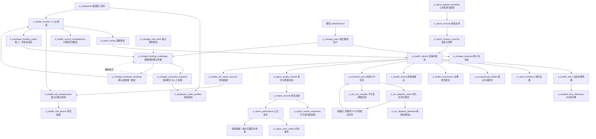

# 健康档案当前业务架构（V001 + V002 + V003 + V004 + V005 + V006）

当前实际库共 **44 张 a_ 表、449 个物理字段**。原31张表保留，业务接入先补充4张支撑表，微信登录和绑定另补充6张独立表，V005增加1张绑定前资料更正申请表，V006增加2张OCR持久调度表。

完整字段、类型、默认值、全部DDL、CHECK、索引、复合外键及写保护触发器见 [逐字段字典](ehr-data-dictionary.html)。接口见 [API文档](ehr-api.md)。原V001架构文件作为初始迁移记录保留，下面是当前运行结构。

## 运行边界

- 身份、报告候选、审核事实和正式发布分别保存；临时草稿不等于个人正式档案。
- 同一逻辑报告可以同时保留已发布 V1 和待修订 V2；所有明细与证据按 report_id + revision 关联。
- 文件存储与数据库分开：MySQL保存受限引用、哈希和元信息；PDF/照片字节在私有目录，下载经过账号或OCR任务鉴权。
- OCR提供方只写候选，不能写正式分类、归档事实或自动生成风险。人工确认是独立动作。
- 归档与outbox在同事务提交；本轮页面直接读取发布事实，后续外部消费者需单独实现。
- 所有新表均以a_开头，不重建旧业务表。scope_code与data_mode作为数据边界。

## 全部表分组

### 身份与档案

- `a_employees`：授权职工身份索引；不存储报告抽取的身份覆盖值
- `a_employee_roster_profiles`：EHR业务授权花名册和生命周期；不修改旧职工表
- `a_health_records`：个人健康档案主记录；每个授权职工一份
- `a_health_record_completeness`：完整度规则计算快照；不是样本PDF字段覆盖率

### 原件与多版本报告

- `a_report_sources`：PDF或照片原始文件；按组织和模式去重
- `a_report_upload_metadata`：每次上传的渠道及元数据；同一原件可有多次上传
- `a_report_series`：逻辑报告；current_revision不是正式发布标记
- `a_health_reports`：报告版本；报告中的身份信息为原始快照
- `a_report_revision_sources`：报告版本与多份原文件的关联

### 报告内容与证据

- `a_report_evidence`：版本内原页、坐标及提取证据
- `a_health_items`：动态检查项目结果；保留原值及原单位
- `a_occupational_profiles`：职业健康字段观察及授权职业资料
- `a_health_conclusions`：医生正式结论；区别于平台风险等级
- `a_health_advice`：报告原文建议或医生确认建议

### 识别、质量与审核

- `a_extraction_jobs`：PDF解析及OCR任务；与审核状态独立
- `a_ocr_dispatch_tasks`：持久OCR领取队列、租约、心跳、超时重试和任务进度
- `a_ocr_dispatch_attempts`：OCR每次领取、心跳及成功失败超时历史，不覆盖旧尝试
- `a_ehr_ocr_receipts`：外部OCR成功回调原始候选快照；不代表审核或归档
- `a_report_quality_checks`：报告版本质量校验结果；按快照摘要和规则版本留痕
- `a_review_records`：医生审核决策历史；退回与驳回分别记录
- `a_report_review_snapshots`：医生审核时的不可变内容快照

### 归档与后续服务

- `a_report_publications`：正式归档凭据；仅允许同摘要的质量通过与医生确认版本
- `a_report_sync_outbox`：正式发布后的事务消息；消费者须幂等处理
- `a_health_risk_assessments`：平台风险评估；不替代职业健康正式医学结论
- `a_health_risk_report_sources`：风险评估所依据的已发布报告版本；保证同一职工与档案
- `a_health_risk_factors`：可解释的风险因素；追溯已发布报告、指标和原页证据
- `a_followup_tasks`：由医生建议产生的随访任务

### 字典、映射及溯源

- `a_standard_field_dictionary`：01表67个字段的版本化定义；必填键不等于报告必有非空值
- `a_medical_item_dictionary`：655种检查项目；词汇映射不等于医学语义确认
- `a_medical_field_mapping`：机构字段及检查项目别名；允许同名多候选
- `a_report_template_mapping`：模板映射；没有原始模板包则不编造种子
- `a_medical_unit_mapping`：单位键目录；未批准转换不得生成标准值
- `a_medical_unit_observations`：390条项目与原单位观察；81个重复单位键无损关联，不是批准规则
- `a_dictionary_source_rows`：Excel十二张表的逐行原样快照；校验规则及待确认记录可追溯

### 微信登录与确认绑定

- `a_miniapp_users`：微信登录身份；不自动生成职工档案、不保存session_key
- `a_miniapp_sessions`：微信小程序独立登录态，未绑定也能持有但不能访问健康档案
- `a_employee_binding_codes`：后台逐人生成的企业身份验证码，确认后一次性消费
- `a_miniapp_binding_challenges`：先校验后预览，再显式确认；不接受客户端回传资料覆盖
- `a_miniapp_employee_bindings`：正式职工绑定及历史；只后台可解除，不能自助换成他人身份
- `a_miniapp_rate_limits`：微信登录及身份验证限流，绑定事务回滚不清空计数
- `a_miniapp_correction_requests`：小程序绑定前的信息更正申请；人工审核通过才更新名册，保留前后快照

### 鉴权、操作及迁移

- `a_ehr_mobile_sessions`：健康档案小程序专用短期令牌，不使用旧明文工号token
- `a_health_archive_audit_logs`：档案业务审计补充；不替换旧平台日志，避免记录明文隐私
- `a_health_schema_migration`：本模块结构迁移版本及输入校验摘要

