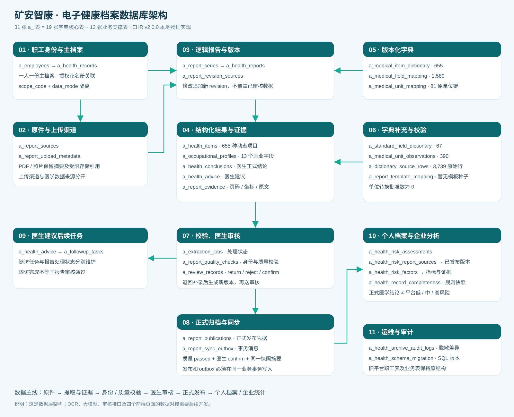
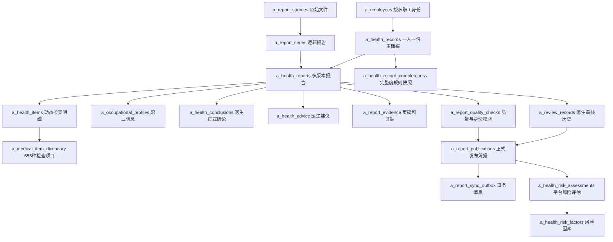

# 矿安智康电子健康档案数据库架构

本设计依据用户提供的 Excel v2.0.0、TXT 业务分析及上传—提取—审核—归档流程图。所有新增表使用 `a_`；原职工、健康档案及其他旧模块均不迁移、不覆盖。

## 输入与契约边界

- 原始工作簿 SHA-256：`8ac2bf8b64d36e420e69b1312a04a1085db2edfc26b7f17b94f5816a9294ba14`。副本和十二张表的只读 JSON 导出位于 `database/reference/v2.0.0/`。
- 核对 01 的 67 个标准字段、02 的 655 个检查项目、03 的 1,589 条别名、04 的 390 条项目单位观察，以及 05/07/08/09 的枚举、校验规则、187 个数据库列定义、126 个接口路径。
- 用户提供的工作簿引用了冻结 SQL 和五个完整 JSON Schema，但这些原文件未随附件提供。本次依据 08 重建核心列、类型、可空性、主外键及索引，依据 09 保留路径语义；**不声称已复原未提供的完整 Schema allOf 条件或与冻结 SQL 字节一致**。本地增加的约束和扩展如下。原项目继续使用 Java，并不因工作簿提及 FastAPI 而更换后端。
- 01 的 `nullable=否` 对应 JSON 容器/键要求时，不代表所有报告都必须识别出非空医学值。缺失内容保留 null，不能补零或编造“正常”。

## 关系概览





完整 45 条物理外键见 [ER Mermaid 源文件](ehr-database-er.mmd)，每张表的列、类型、索引和关系可在 [架构浏览器](ehr-database-architecture.html) 中检索。

## 67 个字段如何落地

| 字段分类 | 数量 | 存储方式 |
|---|---:|---|
| 职工基本信息 | 11 | `a_health_reports.field_values` 保留报告快照；年龄另有 age_raw 镜像 |
| 体检报告信息 | 21 | 报告列与 field_values；原日期保留字符串，核定日期单独保存 |
| 医生正式结论 | 5 | 分项所见/结论保留 field_values；正式结论和建议分别在 conclusions / advice |
| 检查项目明细 | 6 | `a_health_items` 每条检查项目一行，保留原项目名、结果、单位、参考范围、标记和缩写 |
| 原始报告证据 | 11 | evidence 与 field_values；签章标签不是已完成数字签名的声明 |
| 职业健康信息 | 13 | `a_occupational_profiles` 按 field_key 逐项保存；保留报告或授权来源 |

完整逐字段对应关系见 `database/reference/v2.0.0/standard-fields-physical-mapping.csv`。655 种项目是字典行，不能建成 655 个固定结果列；重复字段、多次测量、多版本报告分别保存。

## 12 张支撑表及本地调整

1. `a_report_upload_metadata`：每次上传的渠道、文件名、大小和操作者，支持同原件多次上传记录。五种渠道与医学数据来源分别管理。
2. `a_standard_field_dictionary`：67 个标准字段的版本化元数据，不修改原 JSON 路径。
3. `a_dictionary_source_rows`：保存全部 3,739 条原始字典行及哈希。payload 使用有 JSON_VALID 约束的 LONGTEXT，避免 MySQL JSON 数字规范化改变原始样本覆盖率的小数表示；业务 JSON 仍使用 JSON 列。
4. `a_medical_unit_observations`：390 条项目—原单位观察。04 的 390 行只有 81 个不同 unit_mapping_key；不覆盖、不丢弃重复键。81 行基础单位键暂不绑定某一个项目，390 行观察表保留具体项目。后续获批准的项目级转换须新增版本/专用映射，不能把通用原单位键直接当作批准规则。
5. `a_report_quality_checks`：身份匹配、问题清单、规则版本和报告摘要。身份冲突不能记为通过。
6. `a_report_publications`：明确正式发布事实，要求报告 confirmed、医生决策 confirm、质量 passed，三者报告版本及摘要一致。
7. `a_health_risk_assessments`：平台风险等级及规则版本，与原报告医生正式结论分开。
8. `a_health_risk_report_sources`：风险评估关联同档案的已发布报告版本，避免跨人或混入草稿。
9. `a_health_risk_factors`：风险因素与原始检查值、判定理由、证据关联。
10. `a_health_record_completeness`：规则计算快照。完整度为 completed/required；分母为 0 时 NULL，不默认 100%。所缺材料数须与 missing_items 一致。
11. `a_health_archive_audit_logs`：补充档案细粒度脱敏业务审计，不替换旧平台日志。
12. `a_health_schema_migration`：SQL、来源文件哈希和执行版本。

此外为 health_records 增加 `(scope_code,data_mode,employee_id)` 唯一约束，落实一人一主档案；增加支持发布外键的复合唯一索引、JSON 容器和版本链等 CHECK。标准字段别名的 mapping_version 在本地实现中与 standard_field_dictionary.dictionary_version 同版发布，并有复合外键；今后若需让这两个版本独立演进，应通过显式迁移增加独立字段字典版本引用，不能直接改原版本号。

所有原文件、审核、质量校验及发布凭据仅允许追加；报告及其结果/证据在产生医生审核记录后冻结，退回或修正必须追加下一 revision。冻结由本地触发器保护，不能先写审核记录再补该版本的体检明细。报告镜像字段与 field_values 的一致性、所有 evidence_ids 的有效性及原页范围等仍须由业务校验器核对。

## 审核、退回与正式发布

1. 文件先落受限存储，登记 report_sources / upload_metadata；报告建立 series，识别任务建立 extraction_jobs。
2. 候选版本保存 67 类字段观察、动态指标、结论/建议、职业信息和原页证据，不覆盖企业身份资料。
3. 对同一候选快照执行身份匹配、JSON 校验和 DQ01—DQ13 规则，形成质量记录；失败进入人工补录，不发布。
4. 医生核对原件及快照，追加 review_records。`return` 要求补充后建立新版本；`reject` 保留驳回记录；`confirm` 才能进入发布。
5. **一个数据库事务内**核验 current_revision/CAS 和快照摘要、写医生确认与 reviewed_snapshot_ref、插入 publications 和 outbox。数据库保证发布记录引用确认决策及相同版本/摘要的质量通过记录；服务负责锁、摘要重算、操作者权限和整段事务。
6. 幂等 outbox 消费者更新个人档案投影、完整度/风险快照及统计；消费成功更新 sent。当前 outbox 的 pending/sent 遵循原字典，重试/锁/失败处理需由消费者实现。

`current_revision` 仅为逻辑报告当前候选指针，不能单凭它认定已归档。个人正式档案应以 publications 中每个 report_id 最新已发布 revision 为准；有新草稿时保留上一已发布版本。统计先按员工或逻辑报告去重，不能把多份附件、历史版本当作人数。

四个状态维度分别读取处理任务、报告审核、完整度快照、风险评估。高风险和待审核可以同时存在，不建混合 archive_status。看板“待审核人数”按员工去重；“待审核报告份数”按报告版本计数，标签要明确。完整人数、高风险人数统一使用同一组织、data_mode、时间范围和快照口径。

## 字典初始化与来源保留

| 数据 | 入库数 | 语义 |
|---|---:|---|
| 标准报告字段 | 67 | 来源 01，包含原始元数据 |
| 检查项目 | 655 | 532 lexical_only，123 needs_confirmation；未自动确认 |
| 字段/项目别名 | 1,589 | 522 field，1,067 item；保留机构和多候选，不自动解决同名冲突 |
| 基础原单位键 | 81 | observed_raw_only，无批准转换 |
| 项目—原单位观察 | 390 | 全量保留原单位，批准数 0 |
| 原始字典行 | 3,739 | 12 张工作表逐行快照，包括 536 条待确认记录、规则与来源哈希 |

模板映射原始文件只在 11 中列出了文件名和哈希，未提供实际模板记录，因此 a_report_template_mapping 初始化为空。11 中的外部文件哈希仅作为原文引用，未声称已验证外部文件。字典 validation_ref 为本工作簿行引用，不代表临床批准或原件级验证。

## 对现有项目的衔接

- 旧库 `yh_user_reginfo.user_code`、`yh_org_tree.Org_Code` 等继续提供授权职工和组织资料，使用 roster_employee_key / roster_source_ref 关联；不复制报告姓名去覆盖旧表。
- 老表使用不同字符集和旧业务语义，本次不跨旧表添加强制外键，也不批量建立员工身份映射；新 UUID 与旧 user_code 由后续授权适配器管理。
- 项目原 MySQL Connector/J 8.0.13 读取新表时，实测出现中文结果解码异常；两份源 application-druid.yml 已补充 `characterSetResults=UTF-8`，使用该项目原驱动按新配置读取“姓名”、`kg/m²` 和 655 项字典均通过。源配置修改需在应用下次启动后生效，本次没有重启正在运行的旧模块。参数作用参见 [MySQL 官方会话配置说明](https://dev.mysql.com/doc/connector-j/en/connector-j-connp-props-session.html)。
- 上传目录/对象存储、原件访问鉴权、身份令牌与加密实现、字典批准治理、临床规则及完整度规则须在接口开发时落实。本次不凭空设医学阈值或生产风险分数。
- 时间列约定 UTC；执行器已设置连接会话 `time_zone='+00:00'`。后续 Java 数据源也须配置 UTC 会话和一致的日期序列化，再在页面转换为北京时间。
- 四个页面后续分别对接：智能档案读取已发布个人报告；统计分析读取同口径投影/快照；信息管理处理上传和草稿；审核归档核对证据并执行医生决策。
- **当前前端仍为既有本地演示数据。本次创建数据库结构和字典，不表示 OCR/AI、接口或页面数据联调已完成。**

## 可重复执行与验证

```powershell
python database/build_ehr_schema.py
python database/health_archive_db.py --validate --report database/validation.json
python database/health_archive_db.py --apply --report database/ehr-live-verification.json
python database/generate_ehr_docs.py
```

连接凭据只从项目现有 application-druid.yml 读取，不写进交付文档。执行器先在随机独立库验证，再持命名锁应用到项目库。若发现同名无版本表或校验和冲突则停止，不覆盖已有表。MySQL DDL 不能事务回滚，异常中途留下的 a_ 表需依据执行日志专门处理，不能直接盲目重跑或 DROP 旧表。测试业务记录全部回滚，独立测试库由工具清理。旧通用方案仅在临时库测试过，未应用到项目库；SQL 已移至 database/retracted 并标记 NOT_APPLIED。

验证包括字典与工作簿逐行一致、实际增改查和回滚、组织/模式隔离、唯一主档案、版本链、原件摘要去重、证据版本关联、单位批准门槛、医生确认和质量摘要发布约束、不可修改已审核版本，以及旧表结构指纹比对。

## 表与字段清单

### 职工与主档案

#### `a_employees`（核心）

授权职工身份索引；不存储报告抽取的身份覆盖值。

| 列 | MySQL类型 | 可空 | 说明 |
|---|---|---|---|
| employee_id | CHAR(36) CHARACTER SET ascii COLLATE ascii_bin | 否 | 员工标识 |
| scope_code | VARCHAR(64) CHARACTER SET ascii COLLATE ascii_bin | 否 | 租户或组织范围 |
| data_mode | ENUM('real','synthetic') | 否 | 真实/模拟隔离 |
| roster_employee_key | VARCHAR(96) CHARACTER SET ascii COLLATE ascii_bin | 否 | 按冻结 DDL 列定义使用 |
| identity_ref | VARBINARY(128) | 否 | 按冻结 DDL 列定义使用 |
| roster_source_ref | VARBINARY(256) | 否 | 按冻结 DDL 列定义使用 |
| created_at | DATETIME(6) | 否 | 记录创建时间 UTC |

索引：PK(employee_id)；UNIQUE(scope_code, data_mode, employee_id)；UNIQUE(scope_code, data_mode, roster_employee_key)；UNIQUE(scope_code, data_mode, identity_ref)。

#### `a_health_records`（核心）

个人健康档案主记录；每个授权职工一份。

| 列 | MySQL类型 | 可空 | 说明 |
|---|---|---|---|
| record_id | CHAR(36) CHARACTER SET ascii COLLATE ascii_bin | 否 | 档案标识 |
| scope_code | VARCHAR(64) CHARACTER SET ascii COLLATE ascii_bin | 否 | 租户或组织范围 |
| data_mode | ENUM('real','synthetic') | 否 | 真实/模拟隔离 |
| employee_id | CHAR(36) CHARACTER SET ascii COLLATE ascii_bin | 否 | 员工标识 |
| created_at | DATETIME(6) | 否 | 记录创建时间 UTC |

索引：PK(record_id)；UNIQUE(scope_code, data_mode, record_id)；INDEX(scope_code, data_mode, employee_id, created_at, record_id)；UNIQUE(scope_code, data_mode, employee_id)；UNIQUE(scope_code, data_mode, record_id, employee_id)。

### 原件、报告与识别

#### `a_report_sources`（核心）

PDF或照片原始文件；按组织和模式去重。

| 列 | MySQL类型 | 可空 | 说明 |
|---|---|---|---|
| source_file_id | CHAR(36) CHARACTER SET ascii COLLATE ascii_bin | 否 | 受限原文件标识 |
| scope_code | VARCHAR(64) CHARACTER SET ascii COLLATE ascii_bin | 否 | 租户或组织范围 |
| data_mode | ENUM('real','synthetic') | 否 | 真实/模拟隔离 |
| sha256 | BINARY(32) | 否 | 原始文件摘要 |
| object_ref | VARBINARY(512) | 否 | 按冻结 DDL 列定义使用 |
| page_count | INT UNSIGNED | 否 | 按冻结 DDL 列定义使用 |
| created_at | DATETIME(6) | 否 | 记录创建时间 UTC |

索引：PK(source_file_id)；UNIQUE(scope_code, data_mode, source_file_id)；UNIQUE(scope_code, data_mode, sha256)。

#### `a_report_upload_metadata`（支撑）

每次上传的渠道及元数据；同一原件可有多次上传。

| 列 | MySQL类型 | 可空 | 说明 |
|---|---|---|---|
| upload_id | CHAR(36) CHARACTER SET ascii COLLATE ascii_bin | 否 | upload_id |
| scope_code | VARCHAR(64) CHARACTER SET ascii COLLATE ascii_bin | 否 | scope_code |
| data_mode | ENUM('real','synthetic') | 否 | data_mode |
| source_file_id | CHAR(36) CHARACTER SET ascii COLLATE ascii_bin | 否 | source_file_id |
| request_key | VARCHAR(96) CHARACTER SET ascii COLLATE ascii_bin | 否 | request_key |
| upload_channel | ENUM('miniapp','phone_photo','backend_file','batch_import','legacy_import') | 否 | upload_channel |
| original_file_name | VARCHAR(512) | 否 | original_file_name |
| mime_type | VARCHAR(127) | 否 | mime_type |
| file_size | BIGINT UNSIGNED | 否 | file_size |
| uploader_ref | VARBINARY(256) | 否 | uploader_ref |
| uploaded_at | DATETIME(6) | 否 | UTC时间 |

索引：PK(upload_id)；UNIQUE(scope_code, data_mode, upload_id)；UNIQUE(scope_code, data_mode, request_key)；INDEX(scope_code, data_mode, upload_channel, uploaded_at)。

#### `a_report_series`（核心）

逻辑报告；current_revision不是正式发布标记。

| 列 | MySQL类型 | 可空 | 说明 |
|---|---|---|---|
| report_id | CHAR(36) CHARACTER SET ascii COLLATE ascii_bin | 否 | 逻辑报告 UUID |
| scope_code | VARCHAR(64) CHARACTER SET ascii COLLATE ascii_bin | 否 | 租户或组织范围 |
| data_mode | ENUM('real','synthetic') | 否 | 真实/模拟隔离 |
| source_file_id | CHAR(36) CHARACTER SET ascii COLLATE ascii_bin | 否 | 受限原文件标识 |
| current_revision | INT UNSIGNED | 是 | 当前版本指针 |
| created_at | DATETIME(6) | 否 | 记录创建时间 UTC |

索引：PK(report_id)；UNIQUE(scope_code, data_mode, report_id)；UNIQUE(source_file_id)。

#### `a_health_reports`（核心）

报告版本；报告中的身份信息为原始快照。

| 列 | MySQL类型 | 可空 | 说明 |
|---|---|---|---|
| report_id | CHAR(36) CHARACTER SET ascii COLLATE ascii_bin | 否 | 逻辑报告 UUID |
| revision | INT UNSIGNED | 否 | 报告版本号 |
| scope_code | VARCHAR(64) CHARACTER SET ascii COLLATE ascii_bin | 否 | 租户或组织范围 |
| data_mode | ENUM('real','synthetic') | 否 | 真实/模拟隔离 |
| record_id | CHAR(36) CHARACTER SET ascii COLLATE ascii_bin | 是 | 档案标识 |
| prior_revision | INT UNSIGNED | 是 | 按冻结 DDL 列定义使用 |
| report_kind | ENUM('individual','organization','unknown') | 否 | 按冻结 DDL 列定义使用 |
| institution_raw | TEXT | 是 | 按冻结 DDL 列定义使用 |
| exam_date_raw | TEXT | 是 | 按冻结 DDL 列定义使用 |
| exam_date_verified | DATE | 是 | 按冻结 DDL 列定义使用 |
| report_date_raw | TEXT | 是 | 按冻结 DDL 列定义使用 |
| exam_type_raw | TEXT | 是 | 按冻结 DDL 列定义使用 |
| exam_number_raw | TEXT | 是 | 按冻结 DDL 列定义使用 |
| age_raw | TEXT | 是 | 按冻结 DDL 列定义使用 |
| field_values | JSON | 否 | 版本内字段观察 JSON |
| dictionary_version | VARCHAR(64) CHARACTER SET ascii COLLATE ascii_bin | 否 | 按冻结 DDL 列定义使用 |
| review_status | ENUM('unreviewed','needs_review','confirmed','rejected') | 否 | 复核状态 |
| reviewed_snapshot_ref | VARBINARY(512) | 是 | 已审核快照受限引用 |
| created_at | DATETIME(6) | 否 | 记录创建时间 UTC |

索引：PK(report_id, revision)；UNIQUE(scope_code, data_mode, report_id, revision)；INDEX(scope_code, data_mode, record_id, exam_date_verified)；UNIQUE(scope_code, data_mode, report_id, revision, record_id, review_status)；INDEX(scope_code, data_mode, review_status, created_at)。

#### `a_report_revision_sources`（核心）

报告版本与多份原文件的关联。

| 列 | MySQL类型 | 可空 | 说明 |
|---|---|---|---|
| report_id | CHAR(36) CHARACTER SET ascii COLLATE ascii_bin | 否 | 逻辑报告 UUID |
| revision | INT UNSIGNED | 否 | 报告版本号 |
| source_file_id | CHAR(36) CHARACTER SET ascii COLLATE ascii_bin | 否 | 受限原文件标识 |
| scope_code | VARCHAR(64) CHARACTER SET ascii COLLATE ascii_bin | 否 | 租户或组织范围 |
| data_mode | ENUM('real','synthetic') | 否 | 真实/模拟隔离 |

索引：PK(report_id, revision, source_file_id)。

#### `a_report_evidence`（核心）

版本内原页、坐标及提取证据。

| 列 | MySQL类型 | 可空 | 说明 |
|---|---|---|---|
| report_id | CHAR(36) CHARACTER SET ascii COLLATE ascii_bin | 否 | 逻辑报告 UUID |
| revision | INT UNSIGNED | 否 | 报告版本号 |
| evidence_id | CHAR(36) CHARACTER SET ascii COLLATE ascii_bin | 否 | 按冻结 DDL 列定义使用 |
| source_file_id | CHAR(36) CHARACTER SET ascii COLLATE ascii_bin | 否 | 受限原文件标识 |
| page_number | INT UNSIGNED | 否 | 原件页码，从 1 开始 |
| bbox | JSON | 是 | 按冻结 DDL 列定义使用 |
| coordinate_system | ENUM('pdf_points_unrotated','image_pixels_top_left','object_only') | 否 | 按冻结 DDL 列定义使用 |
| page_rotation | SMALLINT UNSIGNED | 否 | 按冻结 DDL 列定义使用 |
| render_dpi | SMALLINT UNSIGNED | 是 | 按冻结 DDL 列定义使用 |
| original_label | TEXT | 否 | 按冻结 DDL 列定义使用 |
| raw_fragment | MEDIUMTEXT | 是 | 按冻结 DDL 列定义使用 |
| extraction_method | ENUM('native_text','ocr','pdf_object','manual_transcription') | 否 | 按冻结 DDL 列定义使用 |
| extractor_version | VARCHAR(120) | 否 | 按冻结 DDL 列定义使用 |
| ocr_confidence | DECIMAL(8,7) | 是 | OCR 置信度；原生文本留空 |
| review_status | ENUM('unreviewed','needs_review','confirmed','rejected') | 否 | 复核状态 |

索引：PK(report_id, revision, evidence_id)；INDEX(source_file_id, page_number)。

#### `a_extraction_jobs`（核心）

PDF解析及OCR任务；与审核状态独立。

| 列 | MySQL类型 | 可空 | 说明 |
|---|---|---|---|
| job_id | CHAR(36) CHARACTER SET ascii COLLATE ascii_bin | 否 | 按冻结 DDL 列定义使用 |
| report_id | CHAR(36) CHARACTER SET ascii COLLATE ascii_bin | 否 | 逻辑报告 UUID |
| scope_code | VARCHAR(64) CHARACTER SET ascii COLLATE ascii_bin | 否 | 租户或组织范围 |
| data_mode | ENUM('real','synthetic') | 否 | 真实/模拟隔离 |
| request_key | VARCHAR(96) CHARACTER SET ascii COLLATE ascii_bin | 否 | 按冻结 DDL 列定义使用 |
| pipeline_version | VARCHAR(64) CHARACTER SET ascii COLLATE ascii_bin | 否 | 按冻结 DDL 列定义使用 |
| status | ENUM('uploaded','ocr_complete','extracted','standardized','identity_checked','quality_checked','pending_review','failed','published') | 否 | 本实体状态，按列枚举 |
| revision | INT UNSIGNED | 是 | 报告版本号 |
| created_at | DATETIME(6) | 否 | 记录创建时间 UTC |
| updated_at | DATETIME(6) | 否 | 按冻结 DDL 列定义使用 |

索引：PK(job_id)；UNIQUE(scope_code, data_mode, request_key)；INDEX(scope_code, data_mode, status, created_at)。

### 结构化体检数据

#### `a_health_items`（核心）

动态检查项目结果；保留原值及原单位。

| 列 | MySQL类型 | 可空 | 说明 |
|---|---|---|---|
| report_id | CHAR(36) CHARACTER SET ascii COLLATE ascii_bin | 否 | 逻辑报告 UUID |
| revision | INT UNSIGNED | 否 | 报告版本号 |
| item_id | CHAR(36) CHARACTER SET ascii COLLATE ascii_bin | 否 | 按冻结 DDL 列定义使用 |
| ordinal | INT UNSIGNED | 否 | 按冻结 DDL 列定义使用 |
| primary_evidence_id | CHAR(36) CHARACTER SET ascii COLLATE ascii_bin | 否 | 按冻结 DDL 列定义使用 |
| evidence_ids | JSON | 否 | 按冻结 DDL 列定义使用 |
| original_field_name | TEXT | 否 | 原字段名 |
| item_code | VARCHAR(64) CHARACTER SET ascii COLLATE ascii_bin | 是 | 按冻结 DDL 列定义使用 |
| dictionary_version | VARCHAR(64) CHARACTER SET ascii COLLATE ascii_bin | 是 | 按冻结 DDL 列定义使用 |
| standard_field_name | TEXT | 是 | 按冻结 DDL 列定义使用 |
| abbreviation_raw | TEXT | 是 | 按冻结 DDL 列定义使用 |
| result_raw | MEDIUMTEXT | 是 | 检查结果原文 |
| result_normalized | JSON | 是 | 按冻结 DDL 列定义使用 |
| unit_raw | TEXT | 是 | 原单位 |
| unit_normalized | TEXT | 是 | 按冻结 DDL 列定义使用 |
| unit_mapping_key | VARCHAR(64) CHARACTER SET ascii COLLATE ascii_bin | 是 | 按冻结 DDL 列定义使用 |
| unit_mapping_version | VARCHAR(64) CHARACTER SET ascii COLLATE ascii_bin | 是 | 按冻结 DDL 列定义使用 |
| normalization_rule_version | VARCHAR(64) CHARACTER SET ascii COLLATE ascii_bin | 是 | 按冻结 DDL 列定义使用 |
| reference_range_raw | MEDIUMTEXT | 是 | 原参考范围 |
| abnormal_flag_raw | TEXT | 是 | 按冻结 DDL 列定义使用 |
| field_values | JSON | 否 | 版本内字段观察 JSON |
| mapping_status | ENUM('unmapped','lexical_only','needs_confirmation','confirmed') | 否 | 按冻结 DDL 列定义使用 |
| review_status | ENUM('unreviewed','needs_review','confirmed','rejected') | 否 | 复核状态 |

索引：PK(report_id, revision, item_id)；UNIQUE(report_id, revision, ordinal)；INDEX(item_code, dictionary_version)。

#### `a_occupational_profiles`（核心）

职业健康字段观察及授权职业资料。

| 列 | MySQL类型 | 可空 | 说明 |
|---|---|---|---|
| profile_id | CHAR(36) CHARACTER SET ascii COLLATE ascii_bin | 否 | 按冻结 DDL 列定义使用 |
| scope_code | VARCHAR(64) CHARACTER SET ascii COLLATE ascii_bin | 否 | 租户或组织范围 |
| data_mode | ENUM('real','synthetic') | 否 | 真实/模拟隔离 |
| report_id | CHAR(36) CHARACTER SET ascii COLLATE ascii_bin | 是 | 逻辑报告 UUID |
| revision | INT UNSIGNED | 是 | 报告版本号 |
| employee_id | CHAR(36) CHARACTER SET ascii COLLATE ascii_bin | 是 | 员工标识 |
| evidence_id | CHAR(36) CHARACTER SET ascii COLLATE ascii_bin | 是 | 按冻结 DDL 列定义使用 |
| authorized_source_ref | VARBINARY(256) | 是 | 按冻结 DDL 列定义使用 |
| field_key | VARCHAR(64) CHARACTER SET ascii COLLATE ascii_bin | 否 | 按冻结 DDL 列定义使用 |
| original_field_name | TEXT | 否 | 原字段名 |
| value_raw | MEDIUMTEXT | 是 | 按冻结 DDL 列定义使用 |
| value_normalized | JSON | 是 | 按冻结 DDL 列定义使用 |
| review_status | ENUM('unreviewed','needs_review','confirmed','rejected') | 否 | 复核状态 |
| created_at | DATETIME(6) | 否 | 记录创建时间 UTC |

索引：PK(profile_id)；INDEX(employee_id, field_key, created_at)。

#### `a_health_conclusions`（核心）

医生正式结论；区别于平台风险等级。

| 列 | MySQL类型 | 可空 | 说明 |
|---|---|---|---|
| report_id | CHAR(36) CHARACTER SET ascii COLLATE ascii_bin | 否 | 逻辑报告 UUID |
| revision | INT UNSIGNED | 否 | 报告版本号 |
| conclusion_id | CHAR(36) CHARACTER SET ascii COLLATE ascii_bin | 否 | 按冻结 DDL 列定义使用 |
| primary_evidence_id | CHAR(36) CHARACTER SET ascii COLLATE ascii_bin | 否 | 按冻结 DDL 列定义使用 |
| evidence_ids | JSON | 否 | 按冻结 DDL 列定义使用 |
| original_field_name | TEXT | 否 | 原字段名 |
| original_text | MEDIUMTEXT | 是 | 医生正式结论原文 |
| completeness | ENUM('complete','partial','unknown') | 否 | 按冻结 DDL 列定义使用 |
| standard_category | ENUM('目前未见异常','疑似职业病','职业禁忌证','其他疾病或异常') | 是 | 按冻结 DDL 列定义使用 |
| review_status | ENUM('unreviewed','needs_review','confirmed','rejected') | 否 | 复核状态 |

索引：PK(report_id, revision, conclusion_id)。

#### `a_health_advice`（核心）

报告原文建议或医生确认建议。

| 列 | MySQL类型 | 可空 | 说明 |
|---|---|---|---|
| report_id | CHAR(36) CHARACTER SET ascii COLLATE ascii_bin | 否 | 逻辑报告 UUID |
| revision | INT UNSIGNED | 否 | 报告版本号 |
| advice_id | CHAR(36) CHARACTER SET ascii COLLATE ascii_bin | 否 | 按冻结 DDL 列定义使用 |
| source_kind | ENUM('pdf','clinician') | 否 | 按冻结 DDL 列定义使用 |
| source_evidence_id | CHAR(36) CHARACTER SET ascii COLLATE ascii_bin | 是 | 按冻结 DDL 列定义使用 |
| review_id | CHAR(36) CHARACTER SET ascii COLLATE ascii_bin | 是 | 按冻结 DDL 列定义使用 |
| author_ref | VARBINARY(256) | 是 | 按冻结 DDL 列定义使用 |
| original_field_name | TEXT | 是 | 原字段名 |
| text_raw | MEDIUMTEXT | 否 | 建议原文 |
| review_status | ENUM('unreviewed','needs_review','confirmed','rejected') | 否 | 复核状态 |

索引：PK(report_id, revision, advice_id)。

#### `a_followup_tasks`（核心）

由医生建议产生的随访任务。

| 列 | MySQL类型 | 可空 | 说明 |
|---|---|---|---|
| task_id | CHAR(36) CHARACTER SET ascii COLLATE ascii_bin | 否 | 按冻结 DDL 列定义使用 |
| report_id | CHAR(36) CHARACTER SET ascii COLLATE ascii_bin | 否 | 逻辑报告 UUID |
| revision | INT UNSIGNED | 否 | 报告版本号 |
| advice_id | CHAR(36) CHARACTER SET ascii COLLATE ascii_bin | 否 | 按冻结 DDL 列定义使用 |
| status | ENUM('pending','completed','cancelled') | 否 | 本实体状态，按列枚举 |
| due_at | DATETIME(6) | 是 | 按冻结 DDL 列定义使用 |
| created_at | DATETIME(6) | 否 | 记录创建时间 UTC |

索引：PK(task_id)；UNIQUE(report_id, revision, advice_id)；INDEX(status, due_at)。

### 标准与映射字典

#### `a_report_template_mapping`（核心）

模板映射；没有原始模板包则不编造种子。

| 列 | MySQL类型 | 可空 | 说明 |
|---|---|---|---|
| template_key | VARCHAR(64) CHARACTER SET ascii COLLATE ascii_bin | 否 | 按冻结 DDL 列定义使用 |
| mapping_version | VARCHAR(64) CHARACTER SET ascii COLLATE ascii_bin | 否 | 按冻结 DDL 列定义使用 |
| template_kind | ENUM('text_layout','scan_appearance') | 否 | 按冻结 DDL 列定义使用 |
| institution_key | VARCHAR(255) | 是 | 按冻结 DDL 列定义使用 |
| observed_layout | TEXT | 否 | 按冻结 DDL 列定义使用 |
| status | ENUM('needs_confirmation','confirmed','retired') | 否 | 本实体状态，按列枚举 |
| validation_ref | VARBINARY(256) | 是 | 按冻结 DDL 列定义使用 |

索引：PK(template_key, mapping_version)。

#### `a_medical_item_dictionary`（核心）

655种检查项目；词汇映射不等于医学语义确认。

| 列 | MySQL类型 | 可空 | 说明 |
|---|---|---|---|
| item_code | VARCHAR(64) CHARACTER SET ascii COLLATE ascii_bin | 否 | 按冻结 DDL 列定义使用 |
| dictionary_version | VARCHAR(64) CHARACTER SET ascii COLLATE ascii_bin | 否 | 按冻结 DDL 列定义使用 |
| standard_name | VARCHAR(255) | 否 | 按冻结 DDL 列定义使用 |
| semantic_scope | VARCHAR(255) | 否 | 按冻结 DDL 列定义使用 |
| status | ENUM('lexical_only','needs_confirmation','confirmed','retired') | 否 | 本实体状态，按列枚举 |
| validation_ref | VARBINARY(256) | 是 | 按冻结 DDL 列定义使用 |

索引：PK(item_code, dictionary_version)；INDEX(dictionary_version, standard_name)。

#### `a_medical_field_mapping`（核心）

机构字段及检查项目别名；允许同名多候选。

| 列 | MySQL类型 | 可空 | 说明 |
|---|---|---|---|
| mapping_key | VARCHAR(64) CHARACTER SET ascii COLLATE ascii_bin | 否 | 按冻结 DDL 列定义使用 |
| mapping_version | VARCHAR(64) CHARACTER SET ascii COLLATE ascii_bin | 否 | 按冻结 DDL 列定义使用 |
| entry_kind | ENUM('field','item') | 否 | 按冻结 DDL 列定义使用 |
| institution_key | VARCHAR(255) | 是 | 按冻结 DDL 列定义使用 |
| template_key | VARCHAR(64) CHARACTER SET ascii COLLATE ascii_bin | 是 | 按冻结 DDL 列定义使用 |
| template_version | VARCHAR(64) CHARACTER SET ascii COLLATE ascii_bin | 是 | 按冻结 DDL 列定义使用 |
| original_label | VARCHAR(255) | 否 | 按冻结 DDL 列定义使用 |
| normalized_lookup | VARCHAR(255) | 否 | 按冻结 DDL 列定义使用 |
| field_key | VARCHAR(64) CHARACTER SET ascii COLLATE ascii_bin | 是 | 按冻结 DDL 列定义使用 |
| item_code | VARCHAR(64) CHARACTER SET ascii COLLATE ascii_bin | 是 | 按冻结 DDL 列定义使用 |
| dictionary_version | VARCHAR(64) CHARACTER SET ascii COLLATE ascii_bin | 是 | 按冻结 DDL 列定义使用 |
| status | ENUM('needs_confirmation','context_required','lexical_only','confirmed','retired') | 否 | 本实体状态，按列枚举 |
| validation_ref | VARBINARY(256) | 是 | 按冻结 DDL 列定义使用 |

索引：PK(mapping_key, mapping_version)；INDEX(mapping_version, entry_kind, normalized_lookup)。

#### `a_medical_unit_mapping`（核心）

单位键目录；未批准转换不得生成标准值。

| 列 | MySQL类型 | 可空 | 说明 |
|---|---|---|---|
| unit_mapping_key | VARCHAR(64) CHARACTER SET ascii COLLATE ascii_bin | 否 | 按冻结 DDL 列定义使用 |
| mapping_version | VARCHAR(64) CHARACTER SET ascii COLLATE ascii_bin | 否 | 按冻结 DDL 列定义使用 |
| unit_raw | VARCHAR(255) | 否 | 原单位 |
| unit_normalized | VARCHAR(255) | 是 | 按冻结 DDL 列定义使用 |
| item_code | VARCHAR(64) CHARACTER SET ascii COLLATE ascii_bin | 是 | 按冻结 DDL 列定义使用 |
| dictionary_version | VARCHAR(64) CHARACTER SET ascii COLLATE ascii_bin | 是 | 按冻结 DDL 列定义使用 |
| rule_ref | VARBINARY(256) | 是 | 按冻结 DDL 列定义使用 |
| status | ENUM('observed_raw_only','confirmed','retired') | 否 | 本实体状态，按列枚举 |

索引：PK(unit_mapping_key, mapping_version)；INDEX(mapping_version, unit_raw)。

#### `a_medical_unit_observations`（支撑）

390条项目与原单位观察；81个重复单位键无损关联，不是批准规则。

| 列 | MySQL类型 | 可空 | 说明 |
|---|---|---|---|
| dictionary_version | VARCHAR(64) CHARACTER SET ascii COLLATE ascii_bin | 否 | dictionary_version |
| source_row | SMALLINT UNSIGNED | 否 | source_row |
| item_code | VARCHAR(64) CHARACTER SET ascii COLLATE ascii_bin | 否 | item_code |
| unit_mapping_key | VARCHAR(64) CHARACTER SET ascii COLLATE ascii_bin | 否 | unit_mapping_key |
| unit_mapping_version | VARCHAR(64) CHARACTER SET ascii COLLATE ascii_bin | 否 | unit_mapping_version |
| unit_raw | VARCHAR(255) | 否 | unit_raw |
| approval_status | VARCHAR(30) | 否 | approval_status |

索引：PK(dictionary_version, source_row)。

#### `a_standard_field_dictionary`（支撑）

01表67个字段的版本化定义；必填键不等于报告必有非空值。

| 列 | MySQL类型 | 可空 | 说明 |
|---|---|---|---|
| field_key | VARCHAR(64) CHARACTER SET ascii COLLATE ascii_bin | 否 | field_key |
| dictionary_version | VARCHAR(64) CHARACTER SET ascii COLLATE ascii_bin | 否 | dictionary_version |
| field_name | VARCHAR(255) | 否 | field_name |
| field_category | VARCHAR(100) | 否 | field_category |
| target_table | VARCHAR(64) | 否 | target_table |
| target_column | VARCHAR(64) | 否 | target_column |
| json_path | VARCHAR(255) | 否 | json_path |
| definition | JSON | 否 | definition |
| source_row | SMALLINT UNSIGNED | 否 | source_row |

索引：PK(field_key, dictionary_version)。

#### `a_dictionary_source_rows`（支撑）

Excel十二张表的逐行原样快照；校验规则及待确认记录可追溯。

| 列 | MySQL类型 | 可空 | 说明 |
|---|---|---|---|
| workbook_sha256 | BINARY(32) | 否 | workbook_sha256 |
| sheet_index | TINYINT UNSIGNED | 否 | sheet_index |
| source_row | SMALLINT UNSIGNED | 否 | source_row |
| sheet_name | VARCHAR(100) | 否 | sheet_name |
| payload | LONGTEXT | 否 | payload |
| payload_sha256 | BINARY(32) | 否 | payload_sha256 |

索引：PK(workbook_sha256, sheet_index, source_row)。

### 校验、审核与发布

#### `a_report_quality_checks`（支撑）

报告版本质量校验结果；按快照摘要和规则版本留痕。

| 列 | MySQL类型 | 可空 | 说明 |
|---|---|---|---|
| quality_check_id | CHAR(36) CHARACTER SET ascii COLLATE ascii_bin | 否 | quality_check_id |
| scope_code | VARCHAR(64) CHARACTER SET ascii COLLATE ascii_bin | 否 | scope_code |
| data_mode | ENUM('real','synthetic') | 否 | data_mode |
| report_id | CHAR(36) CHARACTER SET ascii COLLATE ascii_bin | 否 | report_id |
| revision | INT UNSIGNED | 否 | revision |
| status | ENUM('passed','failed','needs_review') | 否 | status |
| report_digest | BINARY(32) | 否 | report_digest |
| identity_status | ENUM('matched','conflict','ambiguous','unmatched') | 否 | identity_status |
| issues | JSON | 否 | issues |
| rule_version | VARCHAR(64) CHARACTER SET ascii COLLATE ascii_bin | 否 | rule_version |
| checked_by_ref | VARBINARY(256) | 否 | checked_by_ref |
| checked_at | DATETIME(6) | 否 | UTC时间 |

索引：PK(quality_check_id)；UNIQUE(scope_code, data_mode, quality_check_id)；UNIQUE(scope_code, data_mode, report_id, revision, quality_check_id, status, report_digest)。

#### `a_review_records`（核心）

医生审核决策历史；退回与驳回分别记录。

| 列 | MySQL类型 | 可空 | 说明 |
|---|---|---|---|
| review_id | CHAR(36) CHARACTER SET ascii COLLATE ascii_bin | 否 | 按冻结 DDL 列定义使用 |
| report_id | CHAR(36) CHARACTER SET ascii COLLATE ascii_bin | 否 | 逻辑报告 UUID |
| revision | INT UNSIGNED | 否 | 报告版本号 |
| reviewer_ref | VARBINARY(256) | 否 | 按冻结 DDL 列定义使用 |
| decision | ENUM('return','reject','confirm') | 否 | 按冻结 DDL 列定义使用 |
| reviewed_digest | BINARY(32) | 否 | 按冻结 DDL 列定义使用 |
| decision_key | VARCHAR(96) CHARACTER SET ascii COLLATE ascii_bin | 否 | 按冻结 DDL 列定义使用 |
| issue_disposition | JSON | 否 | 按冻结 DDL 列定义使用 |
| created_at | DATETIME(6) | 否 | 记录创建时间 UTC |

索引：PK(review_id)；UNIQUE(report_id, revision, review_id)；UNIQUE(report_id, revision, decision_key)；UNIQUE(report_id, revision, review_id, decision, reviewed_digest)。

#### `a_report_publications`（支撑）

正式归档凭据；仅允许同摘要的质量通过与医生确认版本。

| 列 | MySQL类型 | 可空 | 说明 |
|---|---|---|---|
| publication_id | CHAR(36) CHARACTER SET ascii COLLATE ascii_bin | 否 | publication_id |
| scope_code | VARCHAR(64) CHARACTER SET ascii COLLATE ascii_bin | 否 | scope_code |
| data_mode | ENUM('real','synthetic') | 否 | data_mode |
| report_id | CHAR(36) CHARACTER SET ascii COLLATE ascii_bin | 否 | report_id |
| revision | INT UNSIGNED | 否 | revision |
| record_id | CHAR(36) CHARACTER SET ascii COLLATE ascii_bin | 否 | record_id |
| review_id | CHAR(36) CHARACTER SET ascii COLLATE ascii_bin | 否 | review_id |
| review_decision | ENUM('return','reject','confirm') | 否 | review_decision |
| report_review_status | ENUM('unreviewed','needs_review','confirmed','rejected') | 否 | report_review_status |
| quality_check_id | CHAR(36) CHARACTER SET ascii COLLATE ascii_bin | 否 | quality_check_id |
| quality_status | ENUM('passed','failed','needs_review') | 否 | quality_status |
| reviewed_digest | BINARY(32) | 否 | reviewed_digest |
| published_by_ref | VARBINARY(256) | 否 | published_by_ref |
| published_at | DATETIME(6) | 否 | UTC时间 |

索引：PK(publication_id)；UNIQUE(scope_code, data_mode, publication_id)；UNIQUE(report_id, revision)；UNIQUE(scope_code, data_mode, record_id, report_id, revision)。

#### `a_report_sync_outbox`（核心）

正式发布后的事务消息；消费者须幂等处理。

| 列 | MySQL类型 | 可空 | 说明 |
|---|---|---|---|
| event_id | CHAR(36) CHARACTER SET ascii COLLATE ascii_bin | 否 | 按冻结 DDL 列定义使用 |
| report_id | CHAR(36) CHARACTER SET ascii COLLATE ascii_bin | 否 | 逻辑报告 UUID |
| revision | INT UNSIGNED | 否 | 报告版本号 |
| review_id | CHAR(36) CHARACTER SET ascii COLLATE ascii_bin | 否 | 按冻结 DDL 列定义使用 |
| status | ENUM('pending','sent') | 否 | 本实体状态，按列枚举 |
| created_at | DATETIME(6) | 否 | 记录创建时间 UTC |

索引：PK(event_id)；UNIQUE(report_id, revision)；INDEX(status, created_at)。

### 档案分析与审计

#### `a_health_risk_assessments`（支撑）

平台风险评估；不替代职业健康正式医学结论。

| 列 | MySQL类型 | 可空 | 说明 |
|---|---|---|---|
| assessment_id | CHAR(36) CHARACTER SET ascii COLLATE ascii_bin | 否 | assessment_id |
| scope_code | VARCHAR(64) CHARACTER SET ascii COLLATE ascii_bin | 否 | scope_code |
| data_mode | ENUM('real','synthetic') | 否 | data_mode |
| record_id | CHAR(36) CHARACTER SET ascii COLLATE ascii_bin | 否 | record_id |
| employee_id | CHAR(36) CHARACTER SET ascii COLLATE ascii_bin | 否 | employee_id |
| assessment_time | DATETIME(6) | 否 | assessment_time |
| risk_score | DECIMAL(12,4) | 是 | risk_score |
| risk_level | ENUM('unknown','low','medium','high','critical') | 否 | risk_level |
| assessment_type | ENUM('rule','clinician','ai_assisted') | 否 | assessment_type |
| rule_version | VARCHAR(64) CHARACTER SET ascii COLLATE ascii_bin | 否 | rule_version |
| assessment_status | ENUM('draft','needs_review','confirmed','superseded') | 否 | assessment_status |
| reviewer_ref | VARBINARY(256) | 是 | reviewer_ref |
| reviewed_at | DATETIME(6) | 是 | reviewed_at |

索引：PK(assessment_id)；UNIQUE(scope_code, data_mode, assessment_id)；UNIQUE(scope_code, data_mode, record_id, assessment_id)；INDEX(scope_code, data_mode, record_id, assessment_status, assessment_time)。

#### `a_health_risk_report_sources`（支撑）

风险评估所依据的已发布报告版本；保证同一职工与档案。

| 列 | MySQL类型 | 可空 | 说明 |
|---|---|---|---|
| scope_code | VARCHAR(64) CHARACTER SET ascii COLLATE ascii_bin | 否 | scope_code |
| data_mode | ENUM('real','synthetic') | 否 | data_mode |
| record_id | CHAR(36) CHARACTER SET ascii COLLATE ascii_bin | 否 | record_id |
| assessment_id | CHAR(36) CHARACTER SET ascii COLLATE ascii_bin | 否 | assessment_id |
| report_id | CHAR(36) CHARACTER SET ascii COLLATE ascii_bin | 否 | report_id |
| revision | INT UNSIGNED | 否 | revision |

索引：PK(assessment_id, report_id, revision)。

#### `a_health_risk_factors`（支撑）

可解释的风险因素；追溯已发布报告、指标和原页证据。

| 列 | MySQL类型 | 可空 | 说明 |
|---|---|---|---|
| factor_id | CHAR(36) CHARACTER SET ascii COLLATE ascii_bin | 否 | factor_id |
| assessment_id | CHAR(36) CHARACTER SET ascii COLLATE ascii_bin | 否 | assessment_id |
| report_id | CHAR(36) CHARACTER SET ascii COLLATE ascii_bin | 否 | report_id |
| revision | INT UNSIGNED | 否 | revision |
| item_id | CHAR(36) CHARACTER SET ascii COLLATE ascii_bin | 是 | item_id |
| evidence_id | CHAR(36) CHARACTER SET ascii COLLATE ascii_bin | 否 | evidence_id |
| factor_name | VARCHAR(255) | 否 | factor_name |
| result_raw | MEDIUMTEXT | 是 | result_raw |
| reason | TEXT | 否 | reason |
| contribution | DECIMAL(12,4) | 是 | contribution |

索引：PK(factor_id)。

#### `a_health_record_completeness`（支撑）

完整度规则计算快照；不是样本PDF字段覆盖率。

| 列 | MySQL类型 | 可空 | 说明 |
|---|---|---|---|
| snapshot_id | CHAR(36) CHARACTER SET ascii COLLATE ascii_bin | 否 | snapshot_id |
| scope_code | VARCHAR(64) CHARACTER SET ascii COLLATE ascii_bin | 否 | scope_code |
| data_mode | ENUM('real','synthetic') | 否 | data_mode |
| record_id | CHAR(36) CHARACTER SET ascii COLLATE ascii_bin | 否 | record_id |
| required_count | INT UNSIGNED | 否 | required_count |
| completed_count | INT UNSIGNED | 否 | completed_count |
| missing_items | JSON | 否 | missing_items |
| rule_version | VARCHAR(64) CHARACTER SET ascii COLLATE ascii_bin | 否 | rule_version |
| basis | JSON | 否 | basis |
| completeness_rate | DECIMAL(7,4) | 是 | 0至1；required_count为0时NULL |
| calculated_at | DATETIME(6) | 否 | UTC时间 |

索引：PK(snapshot_id)；UNIQUE(scope_code, data_mode, snapshot_id)；INDEX(scope_code, data_mode, record_id, calculated_at)。

#### `a_health_archive_audit_logs`（支撑）

档案业务审计补充；不替换旧平台日志，避免记录明文隐私。

| 列 | MySQL类型 | 可空 | 说明 |
|---|---|---|---|
| audit_id | CHAR(36) CHARACTER SET ascii COLLATE ascii_bin | 否 | audit_id |
| scope_code | VARCHAR(64) CHARACTER SET ascii COLLATE ascii_bin | 否 | scope_code |
| data_mode | ENUM('real','synthetic') | 否 | data_mode |
| record_id | CHAR(36) CHARACTER SET ascii COLLATE ascii_bin | 是 | record_id |
| report_id | CHAR(36) CHARACTER SET ascii COLLATE ascii_bin | 是 | report_id |
| revision | INT UNSIGNED | 是 | revision |
| actor_ref | VARBINARY(256) | 否 | actor_ref |
| action | VARCHAR(64) | 否 | action |
| request_key | VARCHAR(96) CHARACTER SET ascii COLLATE ascii_bin | 否 | request_key |
| reason | TEXT | 是 | reason |
| redacted_diff | JSON | 是 | redacted_diff |
| occurred_at | DATETIME(6) | 否 | UTC时间 |

索引：PK(audit_id)；UNIQUE(scope_code, data_mode, audit_id)；UNIQUE(scope_code, data_mode, request_key, action)。

#### `a_health_schema_migration`（支撑）

本模块结构迁移版本及输入校验摘要。

| 列 | MySQL类型 | 可空 | 说明 |
|---|---|---|---|
| version | VARCHAR(64) | 否 | version |
| checksum | CHAR(64) CHARACTER SET ascii COLLATE ascii_bin | 否 | checksum |
| source_sha256 | CHAR(64) CHARACTER SET ascii COLLATE ascii_bin | 否 | source_sha256 |
| description | VARCHAR(500) | 否 | description |
| applied_by | VARCHAR(255) | 否 | applied_by |
| applied_at | DATETIME(6) | 否 | UTC时间 |

索引：PK(version)。

## 本次实际执行结果

- 执行时间：2026-11-14T17:47:38.012651+08:00
- 项目库：192.168.1.109:3306 / shayu_3.0
- applied：True；a_ 表：31；触发器：29；旧表：446；全库表数：477
- 旧表结构保持一致：True；验证项目：34 项。
- 首次执行在登记版本时漏传 source_sha256；DDL 与字典已经落库。修复脚本后，按独立库的结构/触发器摘要与逐行字典核对采用恢复登记，未重新创建或删除业务表。期间网络断线后的核对已恢复完成。旧表结构指纹是在恢复登记及最终验证前后比对；首次失败执行的 SQL 也仅作用于本迁移的 a_ 表。
