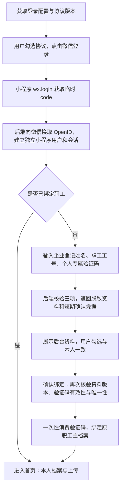

# 矿安智康小程序：微信登录与职工身份绑定接口 V1

本项目只提供后端。小程序由独立开发者实现页面、调用 `wx.login`、勾选协议和信息确认交互。本接口复用已同步的职工主档案，不新建第二份职工身份，也不修改旧账号密码。

## 流程与身份字段



`miniUserId` 是微信小程序用户UUID；`employeeId` 是职工内部UUID；`recordId` 是个人健康主档案UUID；`employeeNo` 是界面上的职工工号。本次旧名册迁移沿用旧系统稳定用户编码作为 `employeeNo`。小程序绑定表单提交的是 `employeeNo`，不是让职工输入UUID。

微信登录只证明微信账号，不等于已核验企业职工身份，也不会自动获取真实姓名、手机号或健康档案。OpenID 只能由本后端调用微信服务核验，不接受客户端自报。后台职工姓名、单位、班组、岗位和电话来自企业名册；昵称头像不作为身份依据。微信官方协议参考：[小程序登录](https://developers.weixin.qq.com/miniprogram/dev/framework/open-ability/login.html)、[code2Session](https://developers.weixin.qq.com/miniprogram/dev/OpenApiDoc/user-login/code2Session.html)。

## 地址、鉴权及返回格式

开发后端：`http://192.168.1.105:18080`（当前A端业务服务器）。`localhost` 只供电脑本机使用。小程序发布时使用实际 HTTPS 地址和平台配置的合法请求域名。当前微信配置与分流对接见 [一键登录快速对接](miniapp-login-quickstart.md)。

新微信接口前缀 **`/ehr/miniapp`**，与早期账号密码接口 `/ehr/mobile` 分开。第三方小程序应使用本文的新流程，不把旧密码登录流程混在微信职工绑定页面中。

成功 HTTP200：`{"code":0,"data":...}`。错误为相应HTTP状态：`{"code":422,"msg":"原因"}`。401 登录无效，403 未绑定/无权限，404 不存在或不是本人，409 绑定或资料版本冲突，422 输入错误，429 请求过频，503 微信参数未配置或微信服务不可用。

登录之后的请求带 `Authorization: Bearer <token>`。令牌随机生成，默认两小时有效；数据库只保存摘要。用户未绑定也能取得令牌，但只能调用自己的状态、身份校验、确认和退出接口。上传与健康数据接口会拒绝未绑定用户。过期时重新 `wx.login`，不要把 OpenID 或工号当成 token。

后台接口继续用医生登录 Cookie，先获取 `/ehr/api/context` 的 `csrfToken`，写请求带 `X-CSRF-Token`。微信用户没有签发验证码、审核档案或后台医生权限。

## 1. 登录配置

`GET /ehr/miniapp/config`，无需登录。

```json
{"code":0,"data":{"wechatConfigured":false,"consentVersion":"2026-11-v1","bindingRequired":true,"loginTokenExpiresIn":7200,"verificationCodeLength":16}}
```

协议页面文本由产品提供并由小程序展示；`consentVersion` 是后端要求的当前版本。用户必须主动勾选，不能默认为true。参数尚未配置时真实微信登录返回503，不能改用演示身份通过。

## 2. 微信一键登录

`POST /ehr/miniapp/wechat/login`

```json
{"code":"wx.login返回的临时code","privacyAccepted":true,"consentVersion":"2026-11-v1"}
```

响应：

```json
{"code":0,"data":{
 "miniUserId":"小程序用户UUID","isNewUser":true,"bindingState":"UNBOUND","canEnterHome":false,"needIdentityVerification":true,"nextAction":"VERIFY_EMPLOYEE",
 "consentVersion":"2026-11-v1","token":"随机Bearer令牌","tokenType":"Bearer","expiresIn":7200,"expiresAt":"2026-11-15T02:00:00Z"
}}
```

登录会话不包含 AppSecret、OpenID 或 session_key；后端不持久化 session_key。同一 AppID、OpenID、数据模式复用同一个小程序用户。unionid只有微信实际返回时保存，不根据客户端值拼接或跨用户合并。

`bindingState` / `nextAction`：

| 状态 | 下一步 | 页面处理 |
|---|---|---|
| UNBOUND | VERIFY_EMPLOYEE | 显示姓名、工号和专属验证码输入页 |
| PENDING_CONFIRMATION | CONFIRM_OR_VERIFY_AGAIN | 有本机仍有效确认凭据时继续核对；凭据丢失则重新验证身份 |
| CORRECTION_PENDING | WAIT_FOR_REVIEW | 展示更正申请及审核进度，暂停确认绑定 |
| BOUND | ENTER_HOME | 进入首页，可访问本人档案和上传 |

## 3. 登录状态与退出

- `GET /ehr/miniapp/me`：当前状态。已绑定时附带当前后台职工资料，手机号脱敏。
- `DELETE /ehr/miniapp/session`：注销当前令牌，返回 `{"loggedOut":true}`。

个人确认凭据只在身份校验成功时返回一次，不通过 `/me` 重发。退出不解除长期职工绑定。

## 4. 验证职工身份，获取确认资料

`POST /ehr/miniapp/binding/verify`，需要 Bearer。

```json
{"name":"企业登记姓名","employeeNo":"106114","verificationCode":"ABCD-EFGH-JKLM-NPQR"}
```

验证码实际是16个排除易混淆字符的随机字符，显示时分为4组；允许忽略横线、空格及字母大小写。示例仅说明格式，不能用于登录。绝不是全员统一的 `123456`。姓名、工号和验证码必须指向同一份后台职工档案。

```json
{"code":0,"data":{
 "bindingState":"PENDING_CONFIRMATION","confirmationToken":"短期随机确认凭据","expiresAt":"2026-11-15T00:10:00Z",
 "employee":{
   "employeeId":"职工UUID","recordId":"档案UUID","name":"企业登记姓名","employeeNo":"106114",
   "gender":"女","birthDate":"1985-03-02","organization":"企业名称","team":"掘进一队","position":"掘进工",
   "phoneMasked":"183****1314","rowVersion":1
 },"notice":"请核对后台提供的本人资料；发现错误请联系企业管理员，不能在此修改身份字段"
}}
```

确认凭据最多10分钟有效，且不会晚于个人验证码过期。这个步骤**不会绑定、不会消费验证码**。接口不支持未验证验证码就按工号、姓名或UUID公开查出个人资料；输入不匹配统一返回422，响应不携带职工信息。

未填写的班组、岗位等保持空值，界面可显示“未填写”；出生日期缺失可为null。小程序只能展示后台返回的内容，不能把用户输入的姓名或单位当成确认资料重新提交覆盖。

## 5. 用户确认绑定

`POST /ehr/miniapp/binding/confirm`

```json
{"confirmationToken":"上一步同一微信用户取得的凭据","confirmed":true}
```

成功返回 `bindingState=BOUND`、`nextAction=ENTER_HOME` 和后台职工资料。必须由取得该确认凭据的同一小程序用户提交，并明确勾选确认。服务端再次检查资料版本、摘要、原验证码、有效期及一人一绑定约束；后台在预览后改过资料会返回409，前端重新验证和展示即可。

成功时在同一事务创建绑定、消费验证码、标记确认凭据已用并追加审计。对同一个已成功确认凭据的重复请求幂等返回当前绑定；不能借此切换另一职工。整个过程不创建新职工主档案。发现资料错误时由企业后台核对修改，本接口不提供“提交另一套个人信息”的覆盖功能。

## 6. 已绑定后的档案与上传

| 方法 | 路径 | 说明 |
|---|---|---|
| GET | `/ehr/miniapp/health-record` | 本人基础资料和已正式归档报告；没有报告时返回空数组 |
| POST | `/ehr/miniapp/reports` | multipart file + Idempotency-Key，服务端按绑定确定目标职工 |
| GET | `/ehr/miniapp/reports/{reportId}/{revision}` | 本人上传处理进度和报告，未归档时 `candidate=true` |
| GET | `/ehr/miniapp/files/{fileId}` | 本人原件下载，其他职工文件返回404 |

沿用已完成的PDF/PNG/JPEG上传规则，单份最多20 MiB。不需要也不接受小程序通过 `recordId` 指定他人作为上传目标。新上传进入“原件已保存/等待识别”，通过外部OCR接收候选并经医生审核归档后才出现在正式个人报告集合中。数据没有自动生成模拟值。

`wx.request` 登录调用示意（前端由小程序开发者实现）：

```javascript
wx.login({success({code}) {
  wx.request({url: `${baseUrl}/ehr/miniapp/wechat/login`, method:'POST',
    data:{code,privacyAccepted:userCheckedAgreement,consentVersion},
    success({statusCode,data}) {
      if(statusCode !== 200 || data.code !== 0) return showError(data.msg);
      saveTokenSecurely(data.data.token);
      routeByBindingState(data.data.bindingState);
    }
  });
}});
// 上传：wx.uploadFile({url: baseUrl+'/ehr/miniapp/reports',name:'file',filePath,
//   header:{Authorization:'Bearer '+token,'Idempotency-Key':uploadRequestUuid}, ...})
```

## 7. 企业后台签发、撤销和换绑

| 方法 | 路径 | 用途 |
|---|---|---|
| GET | `/ehr/api/records/{recordId}/binding` | 当前绑定状态和最近验证码状态，不返回明文验证码或OpenID |
| POST | `/ehr/api/records/{recordId}/binding-code` | 医生为此职工生成独立验证码，明文仅当次返回 |
| DELETE | `/ehr/api/records/{recordId}/binding-code` | 撤销当前未消费验证码，已预览凭据也不能再确认 |
| POST | `/ehr/api/binding-codes/batch` | 1–100人，按档案锁顺序，整批事务签发 |
| POST | `/ehr/api/records/{recordId}/binding/revoke` | 医生核对身份后解除，保留历史并吊销该用户全部会话 |

签发请求：`{"requestKey":"新UUID","expiresIn":86400}`。默认24小时，允许300秒至7天。返回 `codeId`、姓名、工号、`verificationCode`、`expiresAt`、`displayOnce=true`。应私下交给对应职工；不写入聊天日志、接口调试日志或公开列表。

重发立即撤销旧码。相同签发幂等键重试返回409，不生成第二次码，也不重新展示已丢失的明文；需要重发使用新UUID。已绑定职工不能直接签发换绑码，必须先人工解除。后台管理列表已加“微信身份绑定”按钮，支持签发、撤销和填写原因解除。

批量请求是数组：

```json
[
 {"recordId":"第一份职工档案UUID","requestKey":"第一份新UUID","expiresIn":86400},
 {"recordId":"第二份职工档案UUID","requestKey":"第二份新UUID","expiresIn":86400}
]
```

批次任何一项失败整批回滚。解除请求为 `{"reason":"人工核对后的解除原因"}`。解除不会删除报告、原件、职工档案或过去的绑定记录；旧用户重新微信登录后进入未绑定状态。

默认限流：微信登录按IP每分钟60次；身份验证按小程序用户15分钟8次、IP15分钟120次，失败也计数并返回429。IP使用实际连接地址，不信任客户端伪造的转发头。大量用户共用网关时可根据实际部署调整配置和网关策略。

## 8. 数据表与业务边界

此次新增6张表，均为 `a_` 前缀：

| 表 | 作用 |
|---|---|
| a_miniapp_users | 微信身份、AppID/OpenID唯一约束、协议接受版本和状态 |
| a_miniapp_sessions | 独立短期Bearer会话，允许未绑定持有但不授权业务数据 |
| a_employee_binding_codes | 逐人独立验证码摘要、过期、重发、撤销、消费记录 |
| a_miniapp_binding_challenges | 已核验资料的短期确认凭据、资料版本和摘要 |
| a_miniapp_employee_bindings | 一微信用户/一职工有效绑定及解除历史 |
| a_miniapp_rate_limits | 独立事务限流计数，失败回滚不能清空次数 |

审计追加到已有 `a_health_archive_audit_logs`，复用 `a_health_records` 和 `a_employee_roster_profiles`。新微信用户即使还没绑定，也不会被硬塞进旧职工账号表。

## 9. 微信参数与联调

用户已明确先完成接口，稍后配置微信参数。本次不复用旧项目不明用途的AppID或AppSecret。

```text
EHR_WECHAT_APP_ID=这个小程序的真实AppID
EHR_WECHAT_APP_SECRET=这个小程序的真实AppSecret（仅服务端）
```

正式环境固定请求微信 `https://api.weixin.qq.com/sns/jscode2session`。AppSecret和session_key不下发给小程序。配置后重启服务，再用真实小程序 `wx.login` 的新code进行一次真实微信端到端验收。

隔离测试允许 `ehr.data-mode=synthetic` 且 `EHR_WECHAT_TEST_URL` 为本机loopback的服务模拟协议；正式real模式不允许替换微信端点。此测试只验证本后端流程，不代表已完成真实微信认证。正式服务未配置时返回503，不提供演示OpenID登录后门。

## 联调文件与当前限制

可直接导入 [Postman 接口集合](miniapp-wechat-binding.postman_collection.json)。先填 `baseUrl`；真实微信参数配置后再填一次性 `wxCode`。后台请求须先登录医生账号并保留Cookie。生成验证码后只交付对应职工，不导出含实际token和验证码的集合。集合中有生成、撤销和解除绑定等写操作，请逐步执行，不要整组自动运行。

自动验证使用 `synthetic` 模式及本机微信契约服务，不调用真实微信、不绑定真实职工。真实微信端到端登录仍待 AppID/AppSecret 配置及小程序联调。

绑定前资料有误时使用 [信息更正申请 API](miniapp-correction-api.md)，已实现申请、本人进度、后台审核队列与审核通过/驳回；待审期间 `bindingState=CORRECTION_PENDING`、`nextAction=WAIT_FOR_REVIEW`。
