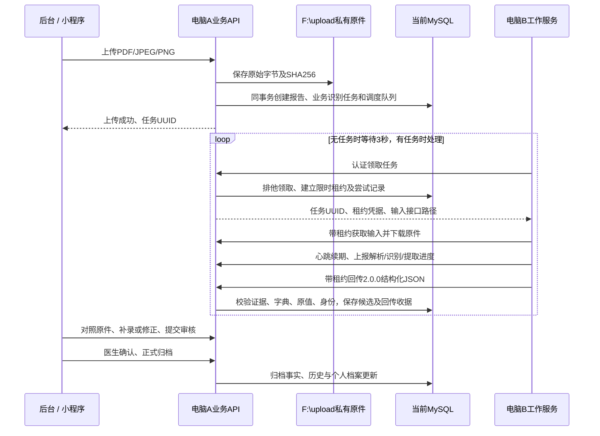

# 矿安智康：电脑 A 上传与 OCR 工作服务接入 V1

当前电脑 A 负责前后端、原件保存、持久任务队列、结果校验入库和医生审核。电脑 B 仅负责现有OCR/AI识别程序，**通过HTTP接口协作，不直接写MySQL**。本轮按已有 `2.0.0` 数据契约实现A端，不实现B端OCR引擎。



## 部署地址与存储

- 电脑A后台端口：`18080`，绑定所有网卡。电脑B使用 **电脑A实际局域网IP**，不能用B自己的localhost。查看A地址：`ipconfig`。
- MySQL继续用项目当前配置 `192.168.1.109:3306/shayu_3.0`，本轮未迁移到另一台电脑。
- 正式原件根目录：**`F:\upload`**。文件采用服务端UUID命名，例如 `UUID.source`，数据库保存原名、类型、大小、页数和哈希；不能从扩展名判断它是否PDF。
- 根目录不作为静态资源目录，浏览器和B端都通过鉴权下载接口读取；不把本地Windows路径当作网络下载地址。
- 配置项 `ehr.storage-root` 或环境变量 `EHR_STORAGE_ROOT` 可覆盖根目录。测试使用独立synthetic目录，避免把测试记录混入正式档案。
- 工作服务密钥文件：`F:\upload\.config\ocr-worker.token`。已在A端生成，文件限制为当前Windows用户、管理员和SYSTEM访问。**本文、代码、Postman中均不包含实际密钥。** B端由负责人私下配置同一密钥。
- 可用 `EHR_OCR_WORKER_TOKEN` 或 `EHR_OCR_WORKER_TOKEN_FILE` 替代默认密钥文件。密钥至少32字符；密钥未配置返回503，错误密钥返回401。

## 一、后台与小程序上传

后台：`POST /ehr/api/records/{recordId}/reports`，医生/管理员Cookie，`X-CSRF-Token`，`Idempotency-Key: 上传UUID`；multipart字段 `file`，可选 `channel=backend_file/phone_photo`。

小程序：`POST /ehr/miniapp/reports`，已经完成职工绑定的Bearer令牌，`Idempotency-Key`，multipart字段`file`。后台从绑定确定职工身份，不接受指定他人档案。旧接口`/ehr/mobile/reports`继续兼容。

PDF支持多页（最多1000页），图片支持真实PNG/JPEG，单文件20 MiB；服务端检查实际字节，不只看文件名。成功返回原有报告对象，增加：

```json
{"jobId":"识别UUID","ocrTask":{"jobId":"同一UUID","state":"queued","stage":"queued","percent":0,"attemptCount":0}}
```

原件保存、报告记录、识别记录与入队在同一业务事务中完成。失败回滚对应元数据和本次新写入临时文件。相同上传幂等键与相同文件返回原报告，不重复入队；不同内容重用旧键返回409。

上传窗口支持选择文件、拖拽、真实传输百分比；保存后转入自动刷新的任务进度。关闭窗口后可通过“识别任务”或报告中的“查看识别进度”再次打开。

## 二、电脑 B 请求规范

所有 `/ehr/worker` 接口带：

```http
Authorization: Bearer <工作服务密钥>
```

领取后，任务输入、下载、心跳、结果、失败回传还必须带：

```http
X-OCR-Lease: <本次领取返回的leaseToken>
```

业务用户令牌不能用于Worker接口，工作服务密钥不能代替后台医生登录。返回统一格式 `{"code":0,"data":...}`，失败使用对应HTTP状态和`msg`。不得把密钥或租约凭据写进访问日志、错误日志或公开页面。

### 1. 领取任务

`POST /ehr/worker/tasks/claim`

```json
{"workerId":"ocr-pc-b-01","requestKey":"本次领取UUID"}
```

workerId为1–80位字母、数字、点、横线或下划线。每个工作循环使用新requestKey；同次请求网络重试沿用。相同有效领取请求返回同一租约，不另领取一份。一个实例可用不同workerId标识多个并行进程，不能让两个正在处理的任务共用同一领取requestKey。

有任务：

```json
{"task":{
 "jobId":"任务UUID","attemptId":"尝试UUID","leaseToken":"本次临时租约凭据",
 "leaseExpiresAt":"UTC到期时间","leaseSeconds":600,"heartbeatSeconds":200,
 "inputPath":"/ehr/worker/tasks/任务UUID/input",
 "progressPath":"/ehr/worker/tasks/任务UUID/heartbeat",
 "resultPath":"/ehr/worker/tasks/任务UUID/result",
 "failurePath":"/ehr/worker/tasks/任务UUID/failure"
}}
```

无任务：`{"task":null,"retryAfterSeconds":3}`。B端等待后再领取，不是用户在A端上传后网络会自动唤醒B。A端租约默认600秒（10分钟），B按响应heartbeatSeconds上报心跳；长PDF处理也必须续期，不能等待整个OCR结束才回传。

### 2. 获取输入与下载

`GET /ehr/worker/tasks/{jobId}/input`

返回报告UUID、revision、contractVersion、files数组，以及冻结契约必填的 `scope_code`、`data_mode`。上下文由A端数据库任务生成，B端必须原样沿用，不能按文件SHA、文件名或本地默认值自行改成synthetic。

```json
{
 "jobId":"任务UUID","job_id":"同一任务UUID",
 "contractVersion":"2.0.0","contract_version":"2.0.0",
 "reportId":"报告UUID","report_id":"同一报告UUID","revision":1,
 "scope_code":"org:10000","data_mode":"real",
 "record_id":"档案UUID","report_kind":"individual","dictionary_version":"2.0.0",
 "files":[],"resultPath":"/ehr/worker/tasks/任务UUID/result"
}
```

上例为正式环境。隔离测试环境返回 `data_mode=synthetic`，不得提交到正式任务。保留camelCase旧字段兼容现有B端，同时提供snake_case契约字段。领取响应也附带scope_code和data_mode；输入响应为完整任务上下文。每份文件含 `id,name,mimeType,size,pageCount,downloadPath`。B拼接A端baseUrl和downloadPath，并继续带两种请求头下载。只允许读取该租约对应任务的原件，不能用另一个任务的fileId下载。

任务输入不返回A的本地文件路径，也不要求两台电脑共享磁盘。input现增加prior_revision、source_files（source_file_id、sha256、page_count）；files也包含sha256，方便B端核对原件并生成冻结契约。完整回传与离线导出绑定示例见 [B端完整JSON对接](b-ocr-result-integration.md)。

### 3. 获取标准字典

`GET /ehr/worker/dictionary`，只需工作服务密钥。

返回 `version=2.0.0`、`standardFields`（67个标准键及定义）、`medicalItems`（655个项目的item_code、standard_name、semantic_scope和状态）。B端按版本缓存。词汇匹配不能自动升级为医学语义确认；没有批准的换算规则时保留原单位和原值。

### 4. 心跳和进度

`POST /ehr/worker/tasks/{jobId}/heartbeat`

```json
{"stage":"field_extraction","percent":60}
```

阶段依次为 `queued → pdf_parse → ocr → field_extraction → item_matching → validation`，percent为0–95，同次尝试不得倒退。没有新增进度时重复提交当前阶段/百分比用于续期。100%和finished只由A端成功入库后设置。页面展示的是B端上报的处理进度，不代表已经医生审核。

### 5. 回传结果

`POST /ehr/worker/tasks/{jobId}/result`

使用既有 [OCR数据契约与示例](ehr-api.md) 中的完整2.0.0 JSON：

```json
{
 "contract_version":"2.0.0","scope_code":"输入中的scope_code","data_mode":"输入中的data_mode",
 "report_kind":"输入中的report_kind","report_id":"输入中报告UUID","revision":1,
 "institution_raw":"机构原文","exam_date_raw":"体检日期原文",
 "evidence":[],"field_values":[],"items":[],"conclusions":[],"advice":[]
}
```

上面空数组仅展示报文顶层结构，不代表识别出了全部内容。真实识别值必须关联实际evidence UUID，包含source_file_id、原始页码、坐标系/可用坐标、提取方式及原文。标准字段用field_key，项目用item_code；没有识别到的字段不能从企业资料或常识编造填入。

完整2.0.0对象可携带source_files及items/conclusions/advice的冻结契约上下文。A会核对原件哈希、页数、嵌套上下文和非空record_id，并保留B端item_id/ordinal、conclusion_id、advice_id。离线样例的DEMO_ONLY、报告/原件UUID及版本号必须先按当前input绑定；不能在A端忽略冲突后写入正式档案。旧格式省略新增元数据仍兼容。

Worker结果必须包含scope_code和data_mode，且与领取任务一致，缺少或不一致返回422，整次候选写入回滚。job_id如提供也必须匹配。report_kind为individual/organization/unknown：个人档案任务允许B返回unknown，表示识别不确定；A保留原回传到收据并保存候选，增加REPORT_KIND_UNCERTAIN质量问题，报告响应requiresReportKindConfirmation=true。医生核对原件后，approve动作必须额外提交reportKindVerified=true，确认属于该职工个人报告，审核记录保留此确认。明确的organization仍不能写入individual任务。旧integration回调允许省略新增上下文字段，但如提供同样校验。

A端检查：任务数据范围与模式、报告与版本、当前任务、租约、原件关联、页码、证据引用、标准字段键、项目字典代码、原始字符串及未批准的派生值。结果原文、单位、参考范围不自动换算。相同任务相同JSON回传幂等；内容不同返回409。业务只保存为needs_review候选；日期仍待核定，医学结论和风险不自动批准。

A会保存自动质量核查记录，姓名缺失/歧义/与上传选定职工不一致会标记需要人工处理，不能自动改绑职工。结构契约不合法返回422/413，整次结果写入回滚，并记录INVALID_RESULT失败，原件保留，修正程序后由后台重试。不要无限重复同一错误报文。

INVALID_RESULT现在保留具体的A端校验原因：后台任务errorMessage、对应attempt的errorMessage均包含HTTP422/413响应中的msg，例如“识别结果与A端任务上下文不一致：data_mode”或“当前未批准归一化或单位转换：result_normalized”。只记录有长度限制的校验说明，不记录整个回传报文、原始病历、工作服务密钥或租约。B端应保留并提供错误响应的msg，不能只显示INVALID_RESULT代码。已成功任务收到不合法的重复回传时，仍保持原有成功结果。

### 6. 回传处理失败

`POST /ehr/worker/tasks/{jobId}/failure`

```json
{"errorCode":"ENGINE_UNAVAILABLE","message":"识别服务暂不可用，请稍后重试","retryable":true}
```

errorCode为1–64位大写字母、数字、下划线，message最多600字符，只写脱敏说明。可重试错误进入retry_wait，按尝试次数等待5、10等秒（最多60秒）；默认最多领取3次。不可重试或预算耗尽进入failed。重复相同失败回传幂等。

## 三、断线、重启与旧结果防护

任务、租约和尝试记录保存在MySQL，A重启不丢队列。A端独立回收器每5秒检查过期租约，服务启动后15秒开始；不启用旧项目的其他业务定时任务。下一次领取也会检查超时任务。

领取和回收使用排他行锁，多个B进程不会领取同一有效任务。每次接管生成新租约，旧租约不能再下载或修改结果。B失联重试达到预算后停留failed，不无限重复。

后台人工补录、提交审核、新修订、停用职工或停止任务会使相关活动任务停止；迟到OCR结果不能覆盖人工候选或已审核版本。重新排队识别会创建新的业务任务，旧任务记录保留。

## 四、后台任务接口

| 方法 | 路径 | 用途 |
|---|---|---|
| GET | `/ehr/api/ocr/tasks?state=active&page=1&limit=10` | 当前组织队列；state还可queued/running/retry_wait/succeeded/failed/cancelled/all |
| GET | `/ehr/api/ocr/tasks/{jobId}` | 当前进度、业务阶段及每次尝试历史，不返回密钥/租约摘要 |
| POST | `/ehr/api/ocr/tasks/{jobId}/retry` | 失败且当前未审核、未被修改的任务重新排队；note+requestKey，增加3次预算 |
| POST | `/ehr/api/ocr/tasks/{jobId}/cancel` | 停止排队或正在处理的任务，保留原件；note+requestKey |
| POST | `/ehr/api/reports/{reportId}/{revision}/ocr` | 对当前未审核版本重新发起识别，旧活动任务停止 |

后台请求使用Cookie，写请求要求X-CSRF-Token。任务按当前企业档案池和real/synthetic隔离。识别完成后的“补录/核对 → 提交审核 → 医生确认 → 正式归档”沿用原业务接口。

## 五、数据库和旧接口

新增V006两张a_表：`a_ocr_dispatch_tasks`（持久队列、当前租约及进度）、`a_ocr_dispatch_attempts`（每次领取和处理结果）。原有 `a_extraction_jobs` 继续表示识别与审核的业务阶段，不能拿它单独控制并发。结果继续存入报告、字段、项目、原页证据、职业信息、质量核验与回传收据表。

旧 `/ehr/integration/jobs/...` 回调接口保留独立EHR_OCR_CALLBACK_TOKEN用于兼容，不再依赖配置submit-url才能入队。已被新工作服务领取的任务不能走旧无租约回调覆盖。新B端统一使用 `/ehr/worker` 契约。

## 六、B端接入清单

1. 启动自己的OCR/AI程序，设置A的实际HTTP地址和工作服务密钥。
2. 领取任务，取得输入和原件；任务处理期间另有心跳循环。
3. 根据67键/655项目字典，调用现有识别程序生成2.0.0 JSON。
4. 成功回传result；引擎或文件错误回传failure；租约失效立即停止该尝试。
5. A端看到结果后由医生核对归档。B端不配置MySQL账号，也不写正式健康档案。

**当前交付为A端接口和页面。真实OCR引擎处理效果仍需电脑B接入后验收。**
