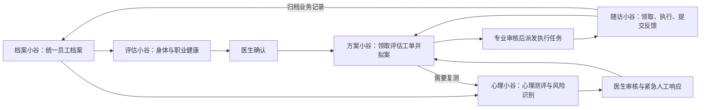

# 心理小谷与五大数字员工工单协作

## 职责与现有服务

心理小谷复用问卷、冻结发布版本、答卷评分、AI 初筛和医生审核；不新建第二套评分系统。AI 调用现有 `DigitalWorkerModelClient` 的数字员工配置，不读取 OCR 配置，不改变现有模型或密钥。

- 档案小谷：统一员工 ID、原始材料及档案管理。
- 评估小谷：身体及职业健康评估。
- 心理小谷：发卷、收卷、评分、心理评估、动态记录与评估移交。
- 方案小谷：统一接收两类评估，拟定方案及执行计划。
- 随访小谷：领取方案执行任务，记录实际反馈。

医生审核是独立环节。AI 参考建议不会发送员工，不等于最终方案或实际联系结果。紧急条目信号在提交答卷同一事务建立人工待办，不等待 AI；未记录人工响应不能结案或移交。

## 菜单入口

现有心理小谷工作台保留，增加工单大厅、评估与医生待办、心理状态监测、测评调度策略。五个工作台共用协作工单入口。

任务调度中心展示两条并列评估路线，汇合方案小谷后再到随访小谷。

## 接口

全部接口使用当前后台登录会话。POST 需要 `GET /ehr/api/context` 返回的 `X-CSRF-Token`。个人资料限定本单位授权医生；非医生仅获得小样本抑制后的汇总。`real` 与 `synthetic` 由服务端会话决定，不能由请求切换。

### 心理工作接口 `/ehr/api/psychology-worker`

| 方法与路径 | 用途 |
|---|---|
| GET 空路径 | 人员覆盖、答卷、待审、紧急待办、方案移交统计与模型配置状态 |
| GET /people?search=&page=1&limit=20 | 授权员工心理管理状态；未测不等于异常 |
| GET /scales | 复用当前量表与评分配置 |
| GET /items?status=&page=1&limit=20 | 测评跟踪、医生审核、复测需求任务 |
| GET /items/{id} | 评分、AI 摘要、医生结果、参考建议、移交状态及审计 |
| GET /records/{recordId}/timeline | 测评历史、医生记录、方案反馈及事件 |
| GET /policies | 本单位调度策略 |
| POST /policies | 新建或更新策略，包含 version、requestKey、document |
| POST /policies/{id}/run | 按已批准策略立即派发，要求 version、requestKey |
| POST /scan | 同步现有答卷和派发任务，不改评分、不发布问卷 |
| POST /items/{id}/actions | claim、review、retry_analysis、emergency_ack、resolve |
| POST /items/{id}/suggestions | 同一 AI API 生成关怀参考，保存在建议表，不发送员工 |
| POST /items/{id}/handoff | 医生已核验评估移交方案小谷，创建真实待领取工单 |
| POST /handoffs/{id}/feedback | 已领取方案工单的进度和复测需求反馈 |

策略 document 示例：

```json
{
  "title":"月度定向心理测评",
  "questionnaireId":"现有问卷UUID",
  "selection":"direct",
  "records":["授权员工档案UUID"],
  "sampleSize":1,
  "intervalDays":30,
  "minimumGapDays":30,
  "durationDays":14,
  "nextRunAt":"2026-12-01T08:00",
  "purpose":"已告知授权的心理健康支持测评",
  "aiEnabled":true
}
```

新策略默认停用。启用需 `enabled:true, professionalConfirmed:true`；后台每分钟检查批准的到期策略。重复运行受策略行锁、周期、模板最小间隔与稳定请求 ID 控制。失败策略自动停用，保留错误供人工核查。只创建系统内问卷待办；微信订阅消息未配置时不得宣称已推送。

移交请求包含 `version, requestKey, dueAt, concerns, professionalConfirmed:true`。服务端从已审核答卷生成快照，含员工 ID、答卷、发布版本、分量表原评分、医生核定等级、审核人/时间、AI 摘要、关注事项和权限范围。客户端不能用未审核答卷绕过直接派心理方案单。

方案反馈包含 `version, requestKey, actingWorker:"plan", state, note, planId, reassessmentRequirement`。state 支持 received/planning/awaiting_review/completed/returned。completed 必须与已验收工单一致；复测要求创建医生待核定任务，不自动向员工发卷。

### 统一工单接口 `/ehr/api/worker-orders`

- GET `?worker=care&tab=hall&page=1&limit=20`
- GET `/{id}`：详情、输入快照、执行结果、完整流转记录；读取记访问审计。
- POST 空路径：创建工单。
- POST `/{id}/actions`：状态操作。

tab：hall（待领取大厅）、queued（待领取）、mine（当前操作者已领取）、sent（当前岗位发出）、acceptance（当前岗位待验收）、history、all。

创建字段：`requestKey, sourceWorker, targetWorker, kind, recordId, reportId?, parentId?, title, instructions, priority, dueAt, payload, dispatch, emergency?`。

worker：archive / assess / care / plan / follow。kind 及允许路线：

| kind | 路线 |
|---|---|
| physical_assessment | archive → assess |
| psychological_assessment | archive → care |
| physical_plan | assess → plan |
| psychological_plan | care → plan，强制关联已审核评估 |
| followup_execution | plan → follow |
| execution_feedback | follow → plan |
| psychological_reassessment | plan → care |
| archive_update | 其他岗位 → archive |

每次操作包含 `requestKey, version, actingWorker, action, note`。

| action | 状态变化与权限 |
|---|---|
| dispatch | 发单岗位：draft → queued |
| claim | 接单岗位：queued → claimed，锁行防重复领取 |
| start | 实际领取人：claimed/returned → in_progress |
| submit | 实际领取人：in_progress → awaiting_acceptance，必须提供非空 result 对象 |
| accept | 发单岗位：awaiting_acceptance → completed；professionalConfirmed:true |
| return | 发单岗位：awaiting_acceptance → returned，说明必填 |
| fail | 实际领取人：in_progress → failed |
| retry | 发单岗位或实际领取人：failed → queued |
| cancel | 发单岗位取消未完成工单；未响应紧急信号不可取消 |
| reassign | 发单岗位，在原职责允许的路线转派，不支持越界改派 |
| emergency_ack | 记录人工响应；要求 contactConfirmed:true 和处置说明 |

当前办理者是登录的专业人员，actingWorker 是其代表办理的岗位，不冒充机器人已自动联系员工。工单保存真实 created_by、claimed_by、accepted_by。模型不能自行领取、验收或修改正式档案。

新建工单不自动调用微信、电话或短信；随访工单结果须实际执行后录入。本轮接入的是派单管理与心理评估移交，未把全体旧任务伪装成新协作流程。



## 数据表与迁移

新增 V037 / V038，全部表使用 `a_` 前缀；只创建缺失表，不删除或改写旧业务数据。

| 表 | 作用及核心字段 |
|---|---|
| a_psych_worker_policies | policy_id、document_json（模板/人员/频率）、enabled、next_run_at、approved_by、last_error、row_version |
| a_psych_worker_items | item_id、record_id、response_id、source_key（唯一去重）、item_kind、task_status、priority、emergency、emergency_ack_by、result_json |
| a_psych_worker_events | event_id、item_id、record_id、action、actor、detail_json、created_at |
| a_psych_worker_handoffs | handoff_id、item_id（唯一）、worker_task_id、source_worker=care、target_worker=plan、assessment_snapshot、handoff_state、feedback_json、confirmed_by、received_by |
| a_psych_worker_suggestions | suggestion_id、record_id、item_id、content、suggestion_state=reference、created_by |
| a_worker_orders | order_id、order_no、parent_id、record_id、report_id、source_worker、target_worker、order_kind、instructions、priority、due_at、order_state、payload_json、result_json、created_by、claimed_by、accepted_by、emergency_ack_by |
| a_worker_order_events | event_id、order_id、acting_worker、actor、action、from_state、to_state、detail_json、created_at |

所有业务表均含 scope_code/data_mode 隔离。可变主表有 row_version；重复请求通过现有持久化回执校验，不重复生成任务。时间审计保存 UTC，策略运行和工单截止按北京时间输入。

## 验证

`tests/ehr/java/PsychologyCollaborationChecks.java` 的 26 项检查在真实数据库事务内验证工单领取、退回验收、越权拒绝、紧急阻断、评估移交、幂等、复测反馈、批准策略真实生成测评待办、重复发放受频率限制和查询。全部回滚，不留下员工派卷或模拟健康记录，不请求外部 AI。

`tests/ehr/check-psychology-workspace.cjs` 使用隔离的模拟网络检查工作台入口、审核移交表单、心理状态时间线、策略编辑器、工单大厅及无 JavaScript 错误。实际登录后的 API 与页面也已验证，未在生产验证中派发真实员工测评或调用外部模型。

### 完整业务联调（2026-11-28）

新增 `tests/ehr/java/PsychologyEndToEndChecks.java`，显式运行时才请求已配置的模型。参数依次为私有 JDBC 配置 JSON、现有数字员工模型配置文件、测试结果 JSON 路径。整个测试在唯一测试范围和 `synthetic` 模式中创建职工；数据库操作最终全部回滚，真实职工不会收到模拟测评或模拟心理结论。

本轮实际验证：创建合成职工 → 发放 PHQ-9/GAD-7 的 16 道题并生成系统内待办 → 本人身份提交合成答案 → 自动评分（PHQ-9=5、GAD-7=3）→ AI 队列 → 审核前禁止员工查看结果和向方案小谷移交 → 模拟专业审核 → 评估快照移交方案小谷 → 领取、开始、提交、上游验收 → 方案处理状态反馈。重复提交未新增答卷，没有创建随访执行任务。

真实外部模型请求返回 `MODEL_HTTP_502`，流式和非流式连通性探测均为上游网关 502。本轮 `businessWorkflowPassed=true`，`modelPassed=false`，完整联调 `success=false`；不得将此轮称为 AI 全链路通过。失败状态和空 AI 输出保留在测试证据中，后续审核与工单状态验证依据合成答卷和后台评分，未伪造模型输出。审核动作仅测试权限和状态转换，不构成真实医生诊断。

本机 `local` 配置已将 `ehr.digital-worker.model-config-file` 连接至现有 `health-agent.json`（可用 `EHR_DIGITAL_WORKER_CONFIG_FILE` 单独覆盖），继续沿用已有 API 和模型，不在源码写入密钥。中转站恢复后重新运行本测试，检查 `modelPassed` 与 `success` 均为 true。

同日再次运行上述完整测试，中转站已恢复：真实模型分析耗时 15.386 秒，输出 864 个字符，`ai_state=completed`、`ai_error=null`。`businessWorkflowPassed=true`、`modelPassed=true`、`success=true`、`rolledBack=true`。方案工单最终为 `completed`，保留创建、领取、开始、提交、验收共 5 条流转事件。测试覆盖业务服务和真实模型调用，审核为合成数据的模拟权限流转；未向真实职工发卷，也不代表已开展真实临床审核或随访。
