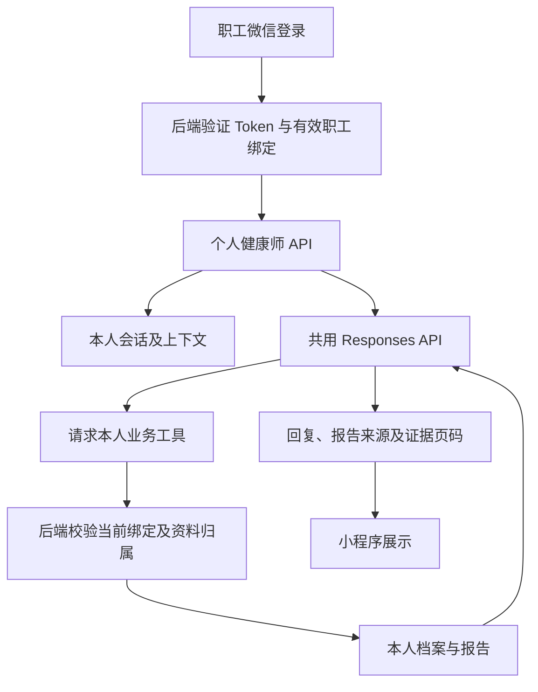

# 小程序个人 AI 健康师：设计与接口契约

状态：设计基线已实现，实际请求/返回格式和联调方式见同目录《小程序个人AI健康师-接口接入说明.md》。已有微信登录、绑定、报告接口继续沿用。

## 1. 产品定位

产品名称：我的 AI 健康师。入口放在小程序首页的「AI 健康助手」，同时允许从「我的体检报告」带报告上下文进入。

共用当前服务端配置的 Responses API 和模型，不为每位职工部署、训练或创建一套独立模型。个性化来自本人真实档案、报告、职业信息与个人对话历史。

| 维度 | 职工之间不同的内容 | 数据来源 |
| --- | --- | --- |
| 身份 | 本人称呼、年龄、岗位、工种、职业暴露 | 已确认的职工绑定及档案 |
| 健康背景 | 本人体检指标、报告结论、医师建议、风险评估 | 当前有权限查看的报告、正式评估 |
| 对话 | 本人的会话列表、提问和回复 | 服务端会话表 |
| 当次分析 | 当前选定报告、版本、证据及问题 | 当次请求及经过权限校验的工具结果 |

首版不引入长期健康记忆表。最近对话可以续接，但健康结论始终重新查询业务数据。用户口述的疾病、用药和症状必须注明「本人自述」，不能自动变成已确诊病史或回写正式档案。

## 2. 已有代码可复用与需新增部分

已检查当前代码：

- `MiniappIdentityController`：已有 `/ehr/miniapp/wechat/login`、`/me`、身份核验与确认接口。
- `MiniappIdentityService.session()`：已校验服务端 Bearer Token、小程序 AppID、用户状态、令牌有效期。
- `MiniappIdentityService.actor()`：已通过有效绑定得到 `boundRecordId`，不需要小程序再次指定职工身份。
- `MiniappReportService`：已有本人报告列表及审核状态区分。
- `HealthAgentClient`：已有 Responses API 工具调用传输，可复用服务端配置及密钥。
- `HealthAgentService/Tools/Store`：已有后台智能体、私有会话、工具审计、删除对话等基础能力。

不能把后台接口直接开放给小程序。后台现有工具包含单位统计和异常聚合；只修改提示词或隐藏页面按钮不足以提供本人隔离。尤其现有 `abnormal()` SQL 以单位为范围，需要新的本人查询条件与独立工具白名单。

建议新增 `MiniappAgentController`、`MiniappAgentService`、`MiniappAgentTools`；共享模型传输与必要的会话存储基础方法，保留后台原有行为。不要通过修改后台全局提示词来实现个人助手。

## 3. 调用架构



小程序只访问 A 端 Java 服务。模型密钥、微信密钥、数据库连接和 OpenID 不返回给模型或小程序页面。按问题读取必要的本人数据，不把整个数据库、全部历史报告或完整身份字段一次性发送给模型。

## 4. 个人隔离规则

每次请求均重新验证：

`mini_user_id + 当前有效 binding_id + subject_record_id + scope_code + data_mode + client_type=miniapp`

1. 只有微信登录且已经确认绑定的职工可以使用个人数据分析。未绑定返回绑定引导。
2. `mini_user_id`、`binding_id`、`record_id`、单位和数据模式全部从服务端 Token 与绑定推导。聊天请求不接受这些身份字段。
3. 对话所有权同时校验用户、渠道、绑定记录、本人档案、单位及数据模式。只校验同单位不够。
4. 每个工具只能操作服务端指定的本人档案；即使模型传入另一位职工的 ID，也拒绝执行。
5. 报告与原件的访问继续走本人报告/下载鉴权，不生成后台管理员链接或公开文件地址。
6. 解除绑定、停用账号、删除职工后，下一次请求立即失败；同一微信重新绑定后不能继续读取旧绑定的会话。
7. 发送模型前、执行每个工具前、持久化并交付最终回复前，重新验证绑定；长请求中途解绑时停止后续查询，不交付旧绑定结果。
8. 小程序不能调用后台操作确认接口，不能查同事名单、单位聚合、他人档案或后台审计。

## 5. 首版工具与能力

| 拟新增工具 | 功能 | 约束 |
| --- | --- | --- |
| get_my_profile | 本人基本健康画像、岗位、工种及暴露信息 | 不接收 record_id；不向模型发送证件号、联系方式或微信标识 |
| list_my_reports | 本人历次报告目录 | 分页，区分待审核、已审核与已归档 |
| get_my_report | 本人指定报告及版本的指标、结论、医师建议、证据 | report_id/revision 必须属于本人；检查项目分页读取 |
| get_my_health_trends | 本人同类指标的历次变化 | 核定日期、单位与来源明确；不混算不可比较的项目 |
| get_my_abnormal_items | 本人报告已有异常标记及关注线索 | 不能使用当前后台单位级异常聚合工具 |
| get_my_confirmed_risks | 本人医生已确认的风险评估及依据 | 未评估显示未评估，不推断为低风险 |

可以回答「我这次哪些指标要注意」「和上次相比有什么变化」「我接触粉尘需要关注什么」「医生给了哪些建议」。

首版仅提供查询、报告解释、生活方式建议与就医/复查提示。不自动修改企业档案、诊断疾病、改变用药、创建随访、发送通知、审核或归档。报告中的提示词、姓名等文本只作数据处理。

默认以已审核报告和正式风险评估为分析依据；用户主动选中本人待审核报告时，可以辅助解释，但回复与来源卡片必须明确标为「待审核候选，仅供核对」，不能当成医生确认结果。

日期、单位、参考范围或证据缺失时直说缺失；趋势缺乏可比较样本时不生成虚构曲线。判断基础病只引用已有明确病史或正式结论；原始异常值仅是关注线索。

## 6. 小程序页面设计

- 顶部：医生形象、「我的 AI 健康师」、当前服务对象「本人」、新建对话与历史对话入口。形象只是展示配置，不参与权限判断；性别未知提供中性默认形象。
- 首屏：简短欢迎语及四个入口「解读体检报告」「看看异常指标」「查看健康变化」「职业健康建议」。没有报告时引导上传，不展示虚构健康评分。
- 聊天区：本人问题、AI 回复、正在查询/分析状态；长文本及表格适配手机。
- 来源卡片：报告日期、机构、版本、审核状态、证据页码，点击打开现有本人报告详情页。
- 输入区：固定底部、支持多行、发送中防重复；首版采用文字输入。上传仍走现有报告上传流程，不直接把附件发给聊天模型。
- 历史区：会话列表、继续对话、单条对话删除；删除前确认，删除聊天不删除报告。

快捷问题应传入真实用户消息，调用同一后端流程；不能用页面预置回复冒充模型分析。

## 7. 拟新增接口

统一前缀：`/ehr/miniapp/agent`。认证：`Authorization: Bearer <微信登录返回的业务Token>`。不接收后台 Shiro Cookie 代替个人 Token。

| 方法 | 路径 | 职责 |
| --- | --- | --- |
| GET | /context | 模型可用状态、本人展示信息、建议问题及绑定状态 |
| POST | /conversations | 为当前用户及当前绑定创建个人对话 |
| GET | /conversations?page=1&pageSize=20 | 当前绑定下本人的历史对话 |
| GET | /conversations/{id} | 本人对话及消息，分页读取 |
| DELETE | /conversations/{id} | 删除本人对话；处理中返回409 |
| POST | /chat | 提交问题，创建持久化处理任务 |
| GET | /messages/{messageId} | 查询本人当次回复、处理状态及来源 |

小程序上传、报告查询和原件下载继续使用已有 `/ehr/miniapp/reports`、`/ehr/miniapp/reports/{id}/{revision}`、`/ehr/miniapp/files/{id}`，不复制新的上传链路。

### 7.1 发送问题示例

```json
{
  "conversationId": "服务端创建的个人会话ID",
  "requestId": "小程序生成并在重试时保持不变的唯一编号",
  "message": "帮我解释这次体检报告，哪些指标需要关注？",
  "context": {
    "reportId": "本人报告ID",
    "revision": 1
  }
}
```

`context` 可不传；传入时必须核验本人报告归属。拒绝客户端额外传入 employeeId、recordId、bindingId、scope、systemPrompt、tools、role、历史工具输出等字段。模型只使用服务端保存的历史。

### 7.2 异步接收示例（HTTP 202）

```json
{
  "code": 0,
  "data": {
    "conversationId": "会话ID",
    "messageId": "本轮任务ID",
    "status": "queued",
    "pollAfterMs": 1500
  }
}
```

采用「发送受理 → 查询结果」以便小程序切后台、网络断开后恢复。不要求小程序维持一个完整模型调用时长的 HTTP 请求。先实现轮询，后续再评估流式输出，不依赖提供方支持保存会话。

### 7.3 查询结果示例（HTTP 200）

```json
{
  "code": 0,
  "data": {
    "conversationId": "会话ID",
    "messageId": "本轮任务ID",
    "status": "completed",
    "answer": "根据你这份报告中的原始结果及医生结论……",
    "sources": [
      {
        "reportId": "本人报告ID",
        "revision": 1,
        "reviewStatus": "confirmed",
        "published": true,
        "pageNumbers": [2, 3],
        "detailPath": "/ehr/miniapp/reports/本人报告ID/1"
      }
    ],
    "dataAsOf": "2026-11-17T12:00:00Z"
  }
}
```

上述数据仅为格式示例，实际答复必须有真实查询依据。`confirmed` 与 `published` 分开表达，审核通过不等于正式归档。

状态：`queued → running → completed / failed`。相同用户、相同会话、相同 requestId 及内容重复提交返回同一 messageId，不重复调用模型；同键不同内容返回409。

错误至少区分：401登录失效；403未绑定/绑定失效；404对话或报告不存在或不属于本人；409处理中/幂等冲突；422参数错误；429限流；503模型暂不可用。业务错误增加稳定的 errorCode，便于小程序决定跳登录、身份认证或显示重试。

用户重开页面后按 messageId 查询任务；失败由用户明确重试，不能因为轮询超时自动新建多次任务。

## 8. 存储与调度设计

沿用已有 `a_miniapp_users`、`a_miniapp_sessions`、`a_miniapp_employee_bindings`，不再新建一份重复微信用户表。

沿用 `a_agent_conversations`、`a_agent_turns`、`a_agent_actions`、`a_agent_tool_logs` 的基础结构；通过正式迁移扩展：

| 表 | 拟扩展字段/约束 | 意义 |
| --- | --- | --- |
| a_agent_conversations | client_type，默认 admin | 显式区分后台与个人端；原会话兼容迁移 |
| a_agent_conversations | subject_record_id，个人端必填 | 会话对应的本人档案 |
| a_agent_conversations | binding_id，个人端必填 | 绑定关系版本；换绑不复用旧历史 |
| a_agent_conversations | 个人查询联合索引 | client_type/owner_user/binding_id/scope_code/data_mode/updated_at |
| a_agent_turns | 增加 queued 状态，处理开始/截止与租约字段 | 持久化排队、超时处理和服务重启恢复 |
| a_agent_turns | message_id 使用现有 turn_id 对外映射 | 避免重复建消息表 |

`owner_user` 个人端可沿用 `wx:<mini_user_id>` 命名，但不能仅依赖这个前缀做授权。所有新增表如后续确有需要，统一 `a_` 前缀；本设计无需为每位职工建表。

个人端不生成 `a_agent_actions` 业务操作票据。删除对话同时清理关联轮次与工具记录，不能绕过运行中保护。撤销绑定后的旧对话暂不可见，按独立保留/清理策略管理，不能自动转移给新绑定人。

异步执行使用独立的有界线程池及持久化任务状态，不复用 OCR 队列，不在数据库事务内等待模型。服务启动时恢复 queued 任务；过期 running 任务标记失败并给出可恢复结果，避免重复计费。

每个用户同一时刻最多一个问题进入执行；同一会话顺序处理。后台与小程序分别限制并发，共同受模型总并发限制，并配置每用户频率、排队上限及每日用量。具体额度通过配置调整，不能以职工人数无限创建线程。

## 9. 实现顺序与验收

1. 扩展会话主体/渠道与异步任务结构，保持后台兼容；编写可复现迁移。
2. 实现个人鉴权上下文、个人专属只读工具与最小数据查询。
3. 接通共用 Responses 客户端；开发个人对话、历史、删除、异步查询接口。
4. 交付小程序接口文档与请求示例，由小程序开发者完成页面接入。
5. 使用两个不同绑定账号及一组未绑定/已解绑账号联调，测试通过后启用真实模型。

必须验收：A 职工不能读取 B 职工会话、报告、原件及来源；不能靠伪造参数或提示词获取单位聚合；解除绑定即时失效；相同 requestId 不重复计费；待审核报告不说成正式结论；缺数据不编造；长报告分页；删除对话不删除职工报告；后台智能体功能不回归。

最终效果：同一个 API 与模型服务，在明确的身份边界内，为每位职工提供基于本人数据和本人历史的健康对话。
